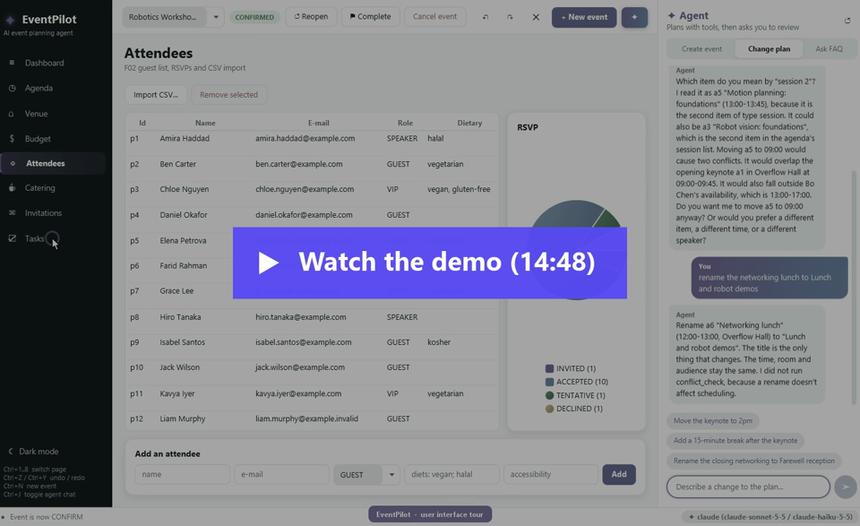
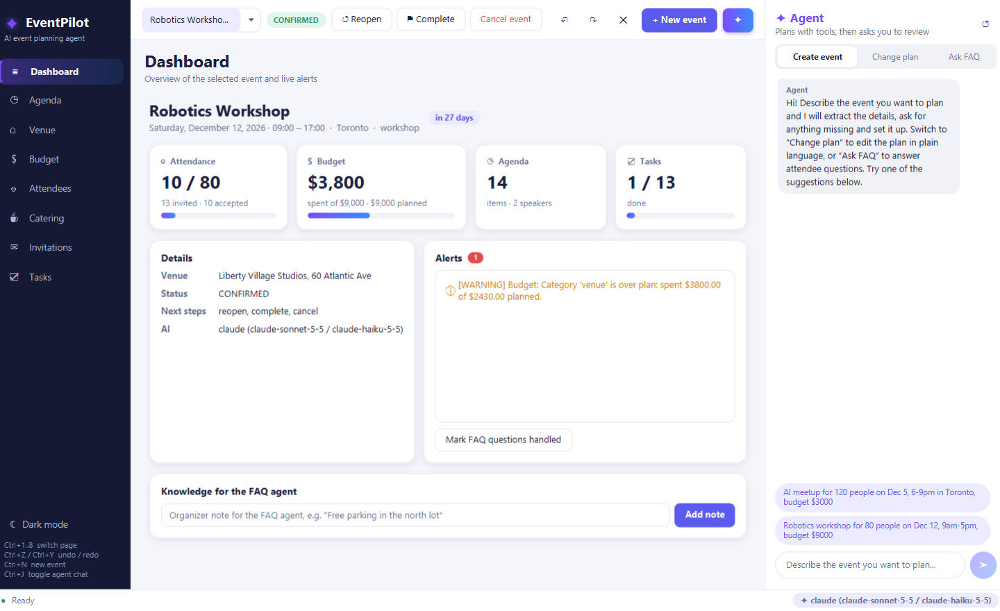

# EventPilot — AI Event Planning Agent

**EECS 3311 Software Design · Fall 2026 · Course Project**
**Author:** Mohammed Faraz Kabbo

EventPilot is an AI agent-based desktop application (JavaFX GUI + picocli CLI) that helps organizers plan events end-to-end. An LLM-based planning agent reasons over the real event state, calls deterministic tools (venue search, budget calculator, conflict checker, speaker availability, catering calculator, attendee query), and proposes concrete, reviewable changes that the organizer approves before they are applied — with full undo/redo.

## Demo video

[](docs/EventPilot_demo_final.mp4)

**[▶ Watch / download the full demo (MP4, 14:48)](docs/EventPilot_demo_final.mp4?raw=true)** · English subtitles are embedded (turn on CC in your player) · <!-- YouTube: add the unlisted link here -->

The video walks through every feature in the GUI and the CLI, using live Claude. Each segment shows the feature ID, how it is invoked, the input, the result, where AI is involved, and an error or alternative case.

| Time | Segment | Time | Segment |
|---|---|---|---|
| 0:00 | UI tour | 6:30 | F07 Budget planning & expenses |
| 0:35 | F01 Create event from a description | 7:46 | F08 Dietary-aware catering |
| 1:35 | F02 Attendees, RSVP & CSV import | 8:41 | F09 Task plan & tracking |
| 2:50 | F03 Venue recommendation | 9:52 | F10 Invitation drafting & sending |
| 3:31 | F04 Agenda generation | 11:03 | F11 Attendee FAQ agent |
| 4:17 | F05 Speaker scheduling | 12:25 | F12 Plain-language plan changes + undo/redo |
| 5:22 | F06 Conflict detection & AI resolution | 14:12 | UC15 Event lifecycle |

The video also contains chapter markers, so players such as VLC can jump straight to a feature.

## Stage status

| Stage | Content | Status |
|---|---|---|
| **Stage 1 — Design** | [Stage 1 Design Report](docs/stage1/Stage1_Design_Report.md) · [PDF](docs/stage1/Stage1_Design_Report.pdf) · [UML diagrams](docs/stage1/diagrams/) | Submitted |
| **Stage 2 — Implementation** | Source code (`src/`), [Stage 2 Implementation Report](docs/stage2/stage2-report.md) (PDF/Word in `docs/stage2/`), updated UML in `docs/stage2/diagrams/` | Submitted |
| Stage 3 — Testing & Agent Validation | JUnit tests, KUMA behavioral tests, failure analysis | next stage |

## Prerequisites

* **Java 17 or newer** (tested with Temurin 17 and Oracle JDK 26). Check with `java -version`.
* Internet access on the first build (Maven downloads the dependencies, including JavaFX).
* No Maven installation is needed — the Maven wrapper (`mvnw` / `mvnw.cmd`) is included.
* Optional: an **Anthropic API key** (Claude) or a local **Ollama** install. Without either, EventPilot runs with its built-in offline planner (see "AI providers").

## Quick start

```powershell
# Windows (PowerShell)
git clone https://github.com/farazkabbo/EECS3311-EventPilot.git
cd EECS3311-EventPilot
.\mvnw.cmd -DskipTests package     # build target/eventpilot.jar
copy .env.example .env             # then put your key in .env (optional)
.\eventpilot.cmd                   # start the GUI
```

```bash
# macOS / Linux
git clone https://github.com/farazkabbo/EECS3311-EventPilot.git
cd EECS3311-EventPilot
./mvnw -DskipTests package
cp .env.example .env
./eventpilot.sh
```

Without a key the app still runs, using the offline planner (see "AI providers").

## 1. Build

```powershell
.\mvnw.cmd -DskipTests package     # Windows (PowerShell); in cmd.exe use mvnw.cmd
./mvnw -DskipTests package         # macOS / Linux
```

This creates `target/eventpilot.jar` (one runnable jar containing the GUI and the CLI). Run the tests with `.\mvnw.cmd test` or `./mvnw test` (101 JUnit tests, no key needed).

## 2. Local configuration and API key (never committed)

```bash
# Windows                         # macOS / Linux
copy .env.example .env            cp .env.example .env
```

Open `.env` and set your values. The file must be named exactly `.env` and sit in the project root (the folder you run the app from); other names such as `.env.local` are not read. `.env` is listed in `.gitignore`; only `.env.example` (placeholders only) is in the repository. Check which provider is active with `eventpilot ai`.

```properties
LLM_PROVIDER=claude                 # claude | ollama | mock
ANTHROPIC_API_KEY=sk-ant-...        # your own key, only in .env
LLM_MODEL=claude-sonnet-5-5         # planning model (tool use)
LLM_LIGHT_MODEL=claude-haiku-5-5    # cheap model for FAQ answers and invitations
OLLAMA_URL=http://localhost:11434   # only for LLM_PROVIDER=ollama
OLLAMA_MODEL=llama3.1:8b
EVENTPILOT_DATA_DIR=data            # SQLite database + e-mail outbox
```

Environment variables with the same names override `.env`.

### AI providers

| `LLM_PROVIDER` | What runs | Needs |
|---|---|---|
| `claude` | Claude through the official Anthropic Java SDK (tool use, Sonnet 5.5 + Haiku 5.5) | `ANTHROPIC_API_KEY` |
| `ollama` | A local model through Ollama (`ollama pull llama3.1:8b`, `ollama serve`) | Ollama running |
| `mock` | **Offline planner**: a deterministic, rule-based stand-in used for tests and demos without a key. It drives the same tool loop and answer formats, but its language understanding is limited to simple patterns. | nothing |

If `LLM_PROVIDER=claude` but no key is set, EventPilot falls back to `mock` and shows "AI: mock" in the status bar / `eventpilot ai`.

## 3. Run

Build first (step 1). Then:

```powershell
# Windows (PowerShell needs the .\ prefix; in cmd.exe just eventpilot.cmd)
.\eventpilot.cmd                    # GUI
.\eventpilot.cmd event list         # CLI
.\eventpilot.cmd --help             # all CLI commands
```

```bash
# macOS / Linux
./eventpilot.sh                     # GUI
./eventpilot.sh event list          # CLI
```

```bash
# or directly, on any OS
java -jar target/eventpilot.jar              # GUI
java -jar target/eventpilot.jar --help       # CLI
```

In the examples below, `eventpilot` stands for `.\eventpilot.cmd` (Windows) or `./eventpilot.sh` (macOS/Linux).

### Troubleshooting

| Problem | Fix |
|---|---|
| `eventpilot.cmd is not recognized` in PowerShell | Use `.\eventpilot.cmd` |
| `Unable to access jarfile target/eventpilot.jar` | Build first: `.\mvnw.cmd -DskipTests package` |
| Status bar / `eventpilot ai` shows `mock` although you have a key | The file must be `.env` in the project root with `LLM_PROVIDER=claude` and `ANTHROPIC_API_KEY=...` |
| `java` not found or version below 17 | Install JDK 17+ and reopen the terminal |
| Start again with an empty database | Close the app and delete the `data/` folder |

### GUI tour

* **Sidebar** (left): Dashboard, Agenda, Venue, Budget, Attendees, Catering, Invitations, Tasks (Ctrl+1…8), and a dark-mode toggle.
* **Agent chat** (right, Ctrl+J to show/hide): *Create event* (describe the event in plain language; answer follow-up questions), *Change plan* ("move the keynote to 2pm and add a 15-minute break after it"), *Ask FAQ* (attendee questions answered from the event's information, with sources).
* **Top bar**: select / create (Ctrl+N) / delete events, status badge, lifecycle buttons (Start planning, Confirm, Reopen, Complete, Cancel), Undo / Redo (Ctrl+Z / Ctrl+Y).
* **Pages**: Dashboard (summary + alerts), Agenda (generate, schedule speakers, check & fix conflicts, modify with AI, speakers), Venue (recommendations), Budget (plan, expenses, chart), Attendees (table, RSVP, CSV import), Catering, Invitations (draft, edit, send), Tasks (board with drag-and-drop).


* Every AI action opens a **review dialog** listing the proposed changes, their reasons, guardrail warnings and the agent's tool calls. Nothing changes until you click *Apply*.

### CLI example session

```bash
eventpilot event create "Plan a robotics workshop for 80 people"
eventpilot event answer "On December 12 from 9am to 5pm in Toronto, budget $9000"
eventpilot attendee import samples/attendees.csv
eventpilot speaker add --name "Ada Park" --topic "robot vision" --available 09:00-13:00
eventpilot venue recommend --needs "wheelchair accessible"      # choose 1-3
eventpilot agenda generate --tracks 1 --topics "Robot vision,Motion planning"
eventpilot agenda schedule
eventpilot agenda conflicts
eventpilot agenda modify "rename the closing networking to Farewell reception"
eventpilot agenda undo
eventpilot budget generate
eventpilot budget expense --category venue --amount 3800 --desc deposit
eventpilot catering plan
eventpilot task generate --team Sam,Lee
eventpilot task status t1 DONE
eventpilot event status start-planning
eventpilot invite draft --tone formal
eventpilot invite send                 # writes e-mails to data/outbox; *.invalid addresses fail on purpose
eventpilot event note "Free parking is available in the north lot."
eventpilot ask "Is there parking?"
eventpilot alerts
eventpilot event status confirm
eventpilot shell                       # interactive mode
```

Add `-y` to approve proposals automatically (never applies proposals with blocking problems), `-e <id>` to work on another event than the selected one, and `--help` to any command.

## Features (F01–F12)

| ID | Feature | GUI | CLI |
|---|---|---|---|
| F01 | Create event from a description (AI + clarifying questions) | Chat ▸ Create event | `event create`, `event answer` |
| F02 | Attendee & RSVP management, CSV import | Attendees | `attendee add/import/rsvp/list` |
| F03 | Venue recommendation (tool use) | Venue | `venue recommend` |
| F04 | Agenda generation | Agenda ▸ Generate | `agenda generate` |
| F05 | Speaker scheduling | Agenda ▸ Auto-schedule | `agenda schedule` |
| F06 | Conflict detection & AI resolution | Agenda ▸ Check / Ask agent to fix | `agenda conflicts/resolve` |
| F07 | Budget planning & expense tracking | Budget | `budget generate/expense/status` |
| F08 | Dietary-aware catering | Catering | `catering summary/plan` |
| F09 | Task plan & tracking | Tasks | `task generate/list/status` |
| F10 | Invitation drafting & sending | Invitations | `invite draft/edit/send` |
| F11 | Attendee FAQ agent (RAG) | Chat ▸ Ask FAQ | `ask` |
| F12 | Plain-language plan changes + undo/redo | Chat ▸ Change plan, Agenda ▸ Modify | `agenda modify/undo/redo` |

## Design patterns (implemented)

Facade (`EventPlannerFacade`), Command (`EventCommand`, `MacroCommand`, `CommandHistory`), Observer (`EventBus`, `AlertService`, `KnowledgeBaseIndexer`, GUI views), Strategy (`LLMClient` + `LLMProvider`: Claude / Ollama / Mock), Template Method (`PlanningWorkflow` + 11 workflows), State (`Event` + `EventState` and 5 states), Adapter (`JsonVenueCatalogAdapter`, `ClaudeProvider`, `OllamaProvider`). Details in the Stage 2 report.

## Repository layout

```
src/main/java/com/eventpilot/
  domain/          Event, Agenda, Attendee, Budget, ... ; domain/state (State pattern); domain/service (rule engines)
  application/     EventPlannerFacade, command/ (Command), event/ (Observer, alerts), proposal/
  agent/           AgentOrchestrator, tools/, llm/ (Strategy + Adapters), workflow/ (Template Method),
                   memory/, rag/, offline/ (offline planner), GuardrailValidator, CommandMapper
  infra/           SQLite repository, venue Adapter, CSV importer, outbox gateway, AppConfig
  cli/             picocli commands      gui/  JavaFX views and controllers
src/main/resources/data/venues.json   sample venue dataset (fictional venues)
samples/attendees.csv                 sample attendees (contains deliberate bad rows)
docs/stage1/ docs/stage2/             reports, UML and screenshots
docs/EventPilot_demo_final.mp4        demo video
```

## Security

No API key or credential is stored in the repository, source code, reports or recordings. Keys live only in the local `.env`. If a key is ever pushed by mistake, revoke it immediately in the provider console and remove it from the git history.
