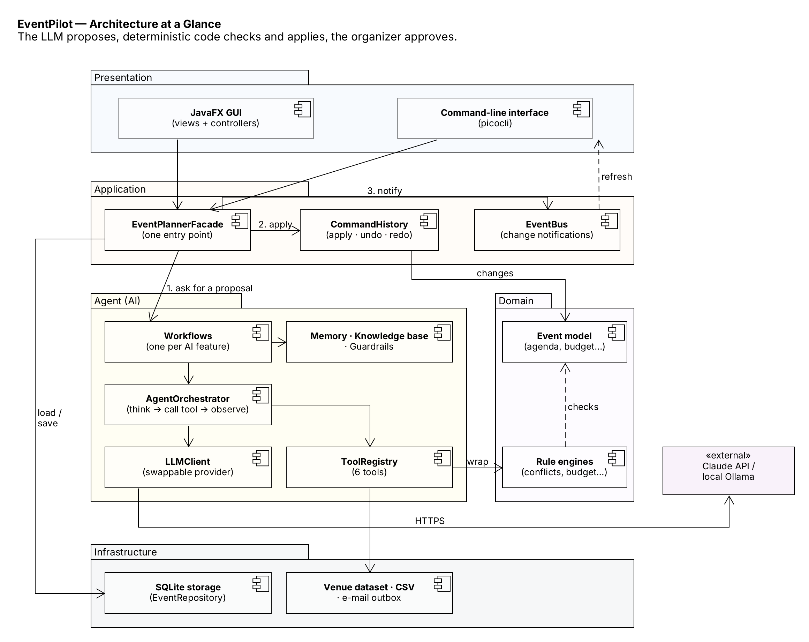

# EventPilot — AI Event Planning Agent

**EECS 3311 Software Design · Fall 2026 · Course Project**
**Author:** Mohammed Faraz Kabbo

EventPilot is an AI agent-based desktop application (JavaFX GUI + picocli CLI) that helps organizers plan events end-to-end. An LLM-based planning agent reasons over the real event state, calls deterministic tools (venue search, budget calculator, conflict checker, speaker availability, catering calculator, attendee query), and proposes concrete, reviewable changes that the organizer approves before they are applied — with full undo/redo.

## Stage status

| Stage | Content | Status |
|---|---|---|
| **Stage 1 — Design** | [Stage 1 Design Report (Markdown)](docs/stage1/Stage1_Design_Report.md) · [PDF](docs/stage1/Stage1_Design_Report.pdf) · [Word](docs/stage1/Stage1_Design_Report.docx) · [UML diagrams](docs/stage1/diagrams/) | Submitted |
| Stage 2 — AI-Human Collaborative Implementation | Source code, AI tool log, design-to-implementation traceability | next stage |
| Stage 3 — Testing & Agent Validation | JUnit tests, KUMA behavioral tests, failure analysis | next stage |

## Stage 1 at a glance

* **12 features** (F01–F12): natural-language event creation, attendees & RSVPs, venue recommendation, agenda generation, speaker scheduling, conflict detection & resolution, budget planning & tracking, dietary-aware catering, task planning, invitations, FAQ agent (RAG), plain-language plan changes with undo/redo.
* **7 design patterns**: Facade, Command, Observer, Strategy, Template Method, State, Adapter.
* **AI models**: Claude Sonnet 5.5 (planning, tool use), Claude Haiku 4.5 (lightweight tasks), Llama 3.1 8B via Ollama (offline), scripted mock (tests).
* **Agent capabilities**: multi-step planning, tool use (6 tools), retrieval (RAG), conversation + preference memory, decision making, human approval of every change, guardrails.
* **UML**: class diagram (overview + 4 views), use-case diagram (2 views) + 15 use-case descriptions, 10 sequence diagrams, lifecycle state diagram, architecture diagram.



## Repository layout

```
docs/stage1/Stage1_Design_Report.md   full Stage 1 report
docs/stage1/Stage1_Design_Report.pdf  printable copy
docs/stage1/Stage1_Design_Report.docx editable Word copy
docs/stage1/diagrams/uxf              UMLet diagram files (.uxf, open with UMLet)
docs/stage1/diagrams/png              exported diagram images
```

## Planned technology

Java 21 · Maven · JavaFX 21 · picocli · Jackson · SQLite (JDBC) · Anthropic Messages API / Ollama · JUnit 5 · Mockito · KUMA
