# EventPilot — An AI Event Planning Agent
### EECS 3311 Software Design · Fall 2026 · Course Project — Stage 1 Design Report

| | |
|---|---|
| **Student** | Mohammed Faraz Kabbo |
| **Student ID** | 219937101 |
| **Repository** | https://github.com/farazkabbo/EECS3311-EventPilot |
| **Date** | October 2026 |

**Contents**

1. [Project Overview](#1-project-overview)
2. [Detailed Feature Specifications](#2-detailed-feature-specifications)
3. [UML Class Diagram](#3-uml-class-diagram)
4. [Design Pattern Explanations](#4-design-pattern-explanations)
5. [Use-Case Diagram](#5-use-case-diagram)
6. [Detailed Use-Case Descriptions](#6-detailed-use-case-descriptions)
7. [Sequence Diagrams](#7-sequence-diagrams)
8. [Feature-to-Design Traceability Table](#8-feature-to-design-traceability-table)
9. [Feature Implementation Explanations](#9-feature-implementation-explanations)

All UML diagrams are drawn in **UMLet**. The editable UMLet files (`.uxf`) are in `docs/stage1/diagrams/uxf/`, and the exported images are in `docs/stage1/diagrams/png/`. The same class and method names are used in every section.

---

## 1. Project Overview

### 1.1 Problem and Motivation

Planning an event such as a 120-person meetup, a student conference or a company workshop means juggling many constraints that affect each other. Sessions must not overlap in the same room. Speakers are only free at certain times. The venue must fit the crowd and the budget. Catering must match confirmed RSVPs and dietary needs. Dozens of tasks have deadlines that depend on each other. And the plan keeps changing, for example "move the keynote to 2 pm".

Small organizers (student clubs, community groups, small businesses) usually do this with spreadsheets, e-mail threads and a generic chatbot. Spreadsheets can do the arithmetic but cannot suggest anything. A chatbot can suggest, but it does not know the real state of the event, invents numbers, and cannot safely change anything. The result is double-booked rooms, forgotten dietary restrictions and budget overruns.

**EventPilot** combines a **deterministic event-management core** with an **AI planning agent**. The core holds the data model, checks conflicts, does the budget arithmetic, enforces the task rules and stores everything. The agent reasons over the real event, calls the core's functions as **tools**, and proposes concrete changes. The organizer approves each proposal before it is applied, and can undo it afterwards.

### 1.2 Target Users

| User | Need |
|---|---|
| **Event organizer** (primary): student-club executives, community coordinators, small-business staff | Turn a rough idea into a complete, consistent plan quickly, and keep it correct as things change |
| **Co-organizer** | See and update the tasks assigned to them |
| **Attendee** | Get quick, correct answers about the event (schedule, food, location) |
| **Power user / TA** | Use every major function from a terminal (CLI) |

### 1.3 What the Agent Does

The agent is a **tool-using planning agent with memory, retrieval and a human-approval step**. It can:

* **Understand:** extract a structured event from a plain-language description, and ask follow-up questions when information is missing.
* **Plan:** create an agenda, schedule speakers, split the budget, design catering and break the event into tasks.
* **Use tools:** search venues, compute budgets and catering portions, check speaker availability, query attendees and run the conflict checker (6 tools).
* **Decide:** rank venues with trade-offs, choose how to fix conflicts, and decide when an attendee question cannot be answered and must go to the organizer.
* **Act safely:** every change it suggests is a list of `EventCommand` objects in a `PlanProposal`. Nothing changes until the organizer approves, and every applied change can be undone.
* **Remember:** conversation memory resolves words like "it" and "the keynote"; preference memory keeps habits such as "prefers 15-minute breaks".
* **Retrieve:** answer attendee questions only from the event's own information, citing the source (RAG).

### 1.4 Why an AI Agent Fits This Problem

| Property of the problem | What a normal app cannot do | What the agent adds |
|---|---|---|
| Requests arrive in natural language | Forms require every field up front | Extraction plus clarifying questions (F01, F12) |
| Planning is open-ended (agenda shape, menu, budget split) | Fixed rules cannot cover every reasonable plan | The LLM generates plans that fit the constraints |
| Plans must obey hard constraints | A chatbot alone invents numbers | The agent calls deterministic tools, and guardrails check its output |
| Work is multi-step (search → check budget → rank → explain) | One prompt cannot gather information step by step | The orchestrator runs a loop of up to 8 tool-using steps |
| The organizer must stay in control | Fully automatic changes are risky | Proposals need approval, and changes can be undone |

**Design principle:** *the LLM reasons and proposes; deterministic code computes, checks and applies.*

### 1.5 AI / LLM Models

| Role | Model | Used for |
|---|---|---|
| Main planning model | **Claude Sonnet 5.5** (`claude-sonnet-5-5`) via the Anthropic Messages API | Planning with tools: agenda, scheduling, conflicts, budget, catering, tasks, plan changes, event extraction |
| Lightweight model | **Claude Haiku 4.5** (`claude-haiku-4-5-20251001`) | Fast, cheap tasks: FAQ answers, invitation drafts |
| Offline option | **Llama 3.1 8B** via **Ollama** (local) | Development without API cost, offline demos |
| Test double | `MockLLMProvider` (scripted replies) | Repeatable automated tests |

The model is chosen in a configuration file (`AppConfig`) and created by `LLMProviderFactory`. Switching models therefore needs no code change (Strategy pattern).

### 1.6 How the AI Interacts with the Rest of the System

The AI never touches the GUI or the database directly. Every AI feature follows the same path:

1. The **GUI controller or CLI command** calls one method on `EventPlannerFacade`.
2. The facade runs the matching **workflow** (`PlanningWorkflow` subclass). The workflow collects context (event data, memory, retrieved documents) and builds the prompt.
3. `AgentOrchestrator` sends the prompt to the LLM through `LLMClient`. When the LLM asks for a tool, `ToolRegistry` checks the arguments and runs the tool, which is ordinary Java code. The result goes back to the LLM. This repeats for at most 8 steps.
4. The workflow **parses** the LLM's JSON answer into objects. If the JSON is invalid it asks the LLM to fix it, up to 2 times. It then **validates** the result with `GuardrailValidator` (capacity, budget, time window, state rules).
5. The facade returns a `PlanProposal` that holds a list of `EventCommand`s. The organizer **reviews** it in a dialog (GUI) or a y/N prompt (CLI).
6. On approval, `CommandHistory` executes the commands, `EventRepository` saves the event, and `EventBus` notifies the views, the alert service and the FAQ index.

### 1.7 Overall Architecture

*Figure 1 — Layered architecture.*

| Layer | Responsibility | Main classes |
|---|---|---|
| Presentation | JavaFX GUI (MVC views and controllers) and picocli CLI | `BaseView` + 6 views, `ChatPanel`, `ProposalReviewDialog`, `BaseController` + 6 controllers, `BaseCliCommand` + 10 commands |
| Application | One entry point; apply, undo and redo changes; notify about changes | `EventPlannerFacade`, `CommandHistory`, `EventCommand`s, `EventBus`, `AlertService`, `KnowledgeBaseIndexer` |
| Agent | Workflows, agent loop, LLM access, tools, memory, retrieval, guardrails | `PlanningWorkflow` + 11 subclasses, `AgentOrchestrator`, `LLMClient`, `LLMProvider`, `ToolRegistry`, 6 tools, `MemoryManager`, `KnowledgeBase`, `GuardrailValidator` |
| Domain | The event model, lifecycle states and rule engines | `Event`, `EventState` + 5 states, `Agenda`, `Budget`, `Attendee`, `ConflictDetector`, `BudgetTracker`, `CateringCalculator`, `TaskScheduler` |
| Infrastructure | Storage, venue data, CSV import, e-mail outbox, configuration | `SqliteEventRepository`, `JsonVenueCatalogAdapter`, `AttendeeCsvImporter`, `OutboxFileGateway`, `AppConfig` |

**Technology:** Java 21, Maven, JavaFX, picocli, Jackson, SQLite (JDBC), Anthropic API / Ollama, JUnit 5 + Mockito (Stage 3A), KUMA (Stage 3B).

**Requirement check:** GUI ✔ · CLI ✔ · 12 features (≥ 10) ✔ · 7 design patterns (≥ 5) ✔ · LLM integrated ✔ · agent behavior: planning, tool use, retrieval, memory, decision making, multi-step execution ✔

### 1.8 Key Design Decisions

| Decision | Reason |
|---|---|
| The LLM **proposes**; deterministic code **checks and applies** | LLM output can be wrong. Arithmetic, conflict checks and data changes stay in testable Java code. |
| Every AI change is a list of `EventCommand`s that the organizer must approve | Keeps the human in control, allows partial approval, and makes every change undoable. |
| Tools are **read-only** and wrap existing domain services | The agent can gather information safely; it can never change the event directly. |
| Tool arguments are checked against a JSON schema before a tool runs | Invalid tool calls are caught and sent back to the LLM instead of causing errors or wrong results. |
| One `PlanningWorkflow` skeleton for all AI features | Retries, parsing, guardrails and tracing are written once and behave the same everywhere. |
| The model is behind the `LLMProvider` interface | Lets us switch between Claude, a local model and a scripted mock for testing without code changes. |
| GUI and CLI both use only `EventPlannerFacade` | Guarantees both interfaces offer the same functionality without duplicated logic. |
| Lifecycle rules live in `EventState` classes | Prevents invalid actions (e.g. inviting people to a cancelled event) in one place. |

---

## 2. Detailed Feature Specifications

| ID | Feature | Type | GUI | CLI |
|---|---|---|---|---|
| F01 | Create event from a description | AI + deterministic validation | Chat panel | `event create "<text>"` |
| F02 | Attendee & RSVP management | Deterministic | Attendees tab | `attendee add / import / rsvp` |
| F03 | Venue recommendation | Hybrid (tool use) | Venue tab | `venue recommend` |
| F04 | Agenda generation | Hybrid | Agenda tab | `agenda generate` |
| F05 | Speaker scheduling | Hybrid (tool use) | Agenda tab | `agenda schedule` |
| F06 | Conflict detection & resolution | Hybrid | Agenda tab | `agenda conflicts / resolve` |
| F07 | Budget planning & expense tracking | Hybrid | Budget tab | `budget generate / expense / status` |
| F08 | Dietary-aware catering plan | Hybrid | Attendees tab ▸ Catering | `catering plan` |
| F09 | Task plan & tracking | Hybrid | Tasks board | `task generate / list / status` |
| F10 | Invitation drafting & sending | AI + deterministic delivery | Attendees tab ▸ Invitations | `invite draft / send` |
| F11 | Attendee FAQ agent (RAG) | AI (retrieval-based) | Chat panel, FAQ mode | `ask "<question>"` |
| F12 | Plain-language plan changes with undo/redo | Hybrid | Chat panel, Agenda tab | `agenda modify "<text>"`, `agenda undo / redo` |

"Hybrid" means that the AI proposes and deterministic code computes and validates.

### F01 — Create Event from a Description

| | |
|---|---|
| **Feature ID and Name** | F01 — Create Event from a Description |
| **Description** | The organizer describes the event in plain language. The agent extracts the name, type, date/time, expected attendance, budget and city, and asks follow-up questions if something required is missing. Once complete, the event is created in the *Draft* state. |
| **User Interaction** | Types in the **Chat panel** (Dashboard ▸ New event ▸ Describe it) and answers follow-up questions in the same chat. |
| **Input** | Free-text description; answers to follow-up questions; saved preferences (e.g. default city). |
| **Output** | A saved `Event` (state = Draft) and a confirmation message. |
| **AI Involvement** | **AI** extraction with **deterministic** validation (`GuardrailValidator.validateDraft`, `EventDraft.missingFields`). |
| **Expected Workflow** | 1. `AgentChatController.submitMessage()` → `EventPlannerFacade.createEventFromDescription()`. 2. `EventExtractionWorkflow` builds the prompt and runs the agent. 3. The reply is parsed into an `EventDraft` and validated. 4. If fields are missing, questions are returned and answers come back through `answerClarification()`. 5. Otherwise `toEvent()` creates the event, it is saved, and the Dashboard refreshes. |
| **Error / Alternative Cases** | LLM unreachable after 3 retries → "use the manual New Event form". Invalid JSON → the LLM is asked to fix it (max 2). Contradictions (end before start) → asked as a question, never guessed. Request is not about an event → politely declined. |

### F02 — Attendee & RSVP Management

| | |
|---|---|
| **Feature ID and Name** | F02 — Attendee & RSVP Management |
| **Description** | Add, edit and remove attendees; import a CSV with row-by-row validation and duplicate detection; record role, dietary restrictions and accessibility needs; track RSVP status. |
| **User Interaction** | **Attendees tab**: table, *Add* form, *Import CSV* button, RSVP drop-down per row, RSVP pie chart. |
| **Input** | Form fields, or a CSV file (`name,email,role,dietary`); RSVP changes. |
| **Output** | Updated attendee list; `ImportReport` (imported / rejected rows with line numbers / duplicates). |
| **AI Involvement** | **Deterministic.** F08, F10 and F11 use this data. |
| **Expected Workflow** | `AttendeeController.onImportCsv()` → `importAttendees()` → `AttendeeCsvImporter.parse()` → valid attendees added → saved → `EventBus.publish(ATTENDEES_CHANGED)` → views refresh and the FAQ index updates. |
| **Error / Alternative Cases** | Missing file or wrong header → error that shows the expected header. Bad rows → rejected individually while the rest import. Duplicate e-mails → skipped and reported. Event Completed/Cancelled → editing refused. |

### F03 — Venue Recommendation

| | |
|---|---|
| **Feature ID and Name** | F03 — Venue Recommendation |
| **Description** | The agent searches the venue dataset with the `venue_search` tool (capacity, city, accessibility, price), checks the venue budget with `budget_calculator`, and returns the top 3 venues with a score, a reason and trade-offs. The organizer picks one. |
| **User Interaction** | **Venue tab ▸ Recommend venues**; three venue cards; the review dialog asks the organizer to choose one. |
| **Input** | The event (attendance, city, date, venue budget); optional extra needs ("needs a stage"). |
| **Output** | `PlanProposal` with up to 3 `SetVenueCommand`s; after approval, the selected `Venue`. |
| **AI Involvement** | **Hybrid**: searching is deterministic (inside the tool), ranking and explaining is AI, and checks are deterministic. |
| **Expected Workflow** | See SD02. `recommendVenues()` → `Event.ensureEditable()` → `VenueRecommendationWorkflow` → agent loop with `VenueSearchTool` → `JsonVenueCatalogAdapter.search()` → parse → validate → review → `applyProposal()`. |
| **Error / Alternative Cases** | Invalid tool arguments → rejected by `ToolRegistry` and sent back to the LLM. No match → the agent may relax only price or district, and says so. A venue not returned by the tool (invented) → blocked by validation. Step limit reached → "refine your criteria". |

### F04 — Agenda Generation

| | |
|---|---|
| **Feature ID and Name** | F04 — Agenda Generation |
| **Description** | Creates a full agenda (sessions, keynote, breaks, meals) inside the event hours, using the organizer's preferences (number of tracks, session length, lunch time). |
| **User Interaction** | **Agenda tab ▸ Generate agenda** → small preferences dialog → review dialog → timeline view. |
| **Input** | Event hours, rooms, speakers and topics, `AgendaPreferences`, saved preferences. |
| **Output** | `PlanProposal` of `AddAgendaItemCommand`s; after approval, the updated `Agenda`. |
| **AI Involvement** | **Hybrid**: the AI designs the structure; the `conflict_check` tool and `GuardrailValidator` ensure correctness. |
| **Expected Workflow** | See SD03. `onGenerateAgenda()` → `generateAgenda()` → `AgendaGenerationWorkflow` → parse with `ProposalParser`/`CommandMapper` → validate → review → `CommandHistory.execute(MacroCommand)` → save → publish. |
| **Error / Alternative Cases** | Items outside event hours or overlapping → warnings (HIGH severity blocks approval). Agenda already exists → choose *replace* or *extend*. Organizer rejects → nothing changes. |

### F05 — Speaker Scheduling

| | |
|---|---|
| **Feature ID and Name** | F05 — Speaker Scheduling |
| **Description** | Assigns speakers to sessions and times so that each speaker is only scheduled when available and never double-booked. |
| **User Interaction** | **Agenda tab ▸ Speakers panel** (add speakers and availability) ▸ *Auto-schedule speakers*. |
| **Input** | Speakers with availability windows, sessions, rooms. |
| **Output** | `PlanProposal` of `AssignSpeakerCommand`s and `MoveSessionCommand`s. |
| **AI Involvement** | **Hybrid**: the agent tries assignments and checks them with `speaker_availability` and `conflict_check` until no serious conflict remains. |
| **Expected Workflow** | See SD04. `onScheduleSpeakers()` → `scheduleSpeakers()` → `SpeakerSchedulingWorkflow` → tool loop → proposal → review & apply. |
| **Error / Alternative Cases** | No speakers or sessions → error before any AI call. Impossible constraints → proposal for the speakers that fit, with an explanation for the others. |

### F06 — Conflict Detection & Resolution

| | |
|---|---|
| **Feature ID and Name** | F06 — Conflict Detection & Resolution |
| **Description** | `ConflictDetector` (plain code) finds room overlaps, speaker double-bookings, speakers outside their availability, rooms that are too small, and items outside event hours. On request, the agent proposes a fix, which is tested on a copy of the event so it cannot create new conflicts. |
| **User Interaction** | **Agenda tab ▸ Check conflicts** (conflicts shown in red) ▸ *Ask agent to fix*. Conflicts also appear automatically as Dashboard alerts. |
| **Input** | The current event. |
| **Output** | `List<Conflict>` (type, severity, items); optionally a `PlanProposal` that fixes them. |
| **AI Involvement** | **Hybrid**: detection is deterministic; the fix is proposed by AI and checked by code. |
| **Expected Workflow** | See SD04. `detectConflicts()` → `ConflictDetector.detect()`. `resolveConflicts()` → `ConflictResolutionWorkflow` → its `validate()` applies the fix to `event.deepCopy()` and runs `detect()` again → review & apply. |
| **Error / Alternative Cases** | No conflicts → "No conflicts found". Fix creates new conflicts → blocked and retried once; if still failing, the remaining conflicts are listed for manual fixing. |

### F07 — Budget Planning & Expense Tracking

| | |
|---|---|
| **Feature ID and Name** | F07 — Budget Planning & Expense Tracking |
| **Description** | The agent proposes how to split the total budget across categories (venue, catering, AV, decor, marketing, contingency) and explains why. `BudgetTracker` does all the math. The organizer then records real expenses, sees planned vs. spent, and gets alerts. |
| **User Interaction** | **Budget tab**: *Generate budget plan*, budget table, bar chart, *Add expense* form; alerts show on the Dashboard. |
| **Input** | Budget limit, event type and size; expenses (category, amount, date, description). |
| **Output** | `PlanProposal` of `SetBudgetLineCommand`s; `BudgetStatus`; alerts. |
| **AI Involvement** | **Hybrid**: the AI chooses the split; the arithmetic and alerts are deterministic. |
| **Expected Workflow** | See SD05. Plan: `generateBudget()` → `BudgetPlanningWorkflow` → `BudgetCalculatorTool` → `BudgetTracker.allocate()` → validate (total ≤ limit) → review & apply. Expense: `onRecordExpense()` → `recordExpense()` → `BudgetTracker.recordExpense()` → save → publish → `AlertService` checks status. |
| **Error / Alternative Cases** | No limit set → asked to set one. Negative amount or missing category → form error. Plan over the limit → blocked. Category over plan or ≥ 90 % spent → alert. |

### F08 — Dietary-Aware Catering Plan

| | |
|---|---|
| **Feature ID and Name** | F08 — Dietary-Aware Catering Plan |
| **Description** | Code computes the confirmed headcount and dietary counts from RSVPs. The agent then designs meals that line up with agenda breaks, menus that cover every dietary need, portions (from the `catering_calculator` tool) and an estimated cost. |
| **User Interaction** | **Attendees tab ▸ Catering**: dietary summary, *Plan catering* button, meal cards. |
| **Input** | Confirmed attendees and their diets, meal breaks, catering budget line. |
| **Output** | `PlanProposal` with a `SetCateringPlanCommand` → `CateringPlan`. |
| **AI Involvement** | **Hybrid**: facts are computed by code, the menu by AI, and coverage and cost are checked by code. |
| **Expected Workflow** | See SD06. `planCatering()` → `CateringPlanningWorkflow` uses `CateringCalculator.computeHeadcount()` and `summarizeDiets()` → agent loop → validate (every diet covered, cost within budget) → review & apply. |
| **Error / Alternative Cases** | No RSVPs yet → uses expected attendance with a warning. A diet not covered → blocked and retried once. Over budget → warning with the amount. |

### F09 — Task Plan & Tracking

| | |
|---|---|
| **Feature ID and Name** | F09 — Task Plan & Tracking |
| **Description** | The agent breaks the event into tasks with owners, deadlines and dependencies, planning backwards from the event date. `TaskScheduler` checks for circular dependencies and orders the tasks. Co-organizers update task status on a board, and overdue tasks raise alerts. |
| **User Interaction** | **Tasks board** (To do / In progress / Done) with drag-and-drop and *Generate task plan*. |
| **Input** | Event date, type, what is already done, team member names. |
| **Output** | `PlanProposal` of `AddTaskCommand`s; task status changes; overdue alerts. |
| **AI Involvement** | **Hybrid**: the AI breaks down the work; dependency, ordering and overdue rules are deterministic. |
| **Expected Workflow** | See SD07. `generateTasks()` → `TaskDecompositionWorkflow` → `TaskScheduler.detectCycles()` / `orderByDependencies()` → review & apply. `updateTaskStatus()` checks dependencies. `AlertService.checkOverdueTasks()` runs at start-up and every morning. |
| **Error / Alternative Cases** | Circular dependency or deadline after the event → blocked and retried once. Marking a task done while a dependency is open → refused with "blocked by …". |

### F10 — Invitation Drafting & Sending

| | |
|---|---|
| **Feature ID and Name** | F10 — Invitation Drafting & Sending |
| **Description** | Drafts invitations in a chosen tone (formal / friendly / playful), personalised per attendee group (speakers, VIPs, guests). Each draft is checked to contain the real date, time and venue, can be edited, and is then sent to the e-mail outbox. Allowed only when the event is in *Planning* or *Confirmed*. |
| **User Interaction** | **Attendees tab ▸ Invitations**: tone selector, *Draft*, editable previews, *Send*, delivery report. |
| **Input** | Event details, attendees and roles, tone, organizer edits. |
| **Output** | `List<Invitation>`; `DeliveryReport` (sent / failed). |
| **AI Involvement** | **AI** writing with **deterministic** fact checks and delivery. |
| **Expected Workflow** | See SD08. `draftInvitations()` → `Event.ensureCanInvite()` (decided by the current `EventState`) → `InvitationDraftingWorkflow` → drafts shown → `sendInvitations()` → `MessageGateway.send()` for each attendee. |
| **Error / Alternative Cases** | Wrong state → refused with guidance. Draft missing the date or venue → regenerated. A single failed delivery → recorded, and the rest are still sent. |

### F11 — Attendee FAQ Agent (RAG)

| | |
|---|---|
| **Feature ID and Name** | F11 — Attendee FAQ Agent (RAG) |
| **Description** | Attendees ask questions in plain language. The system retrieves the most relevant pieces of the event's information (agenda, venue, catering, organizer notes), and the agent answers **only** from them, naming its sources. If nothing relevant is found, the question goes to the organizer instead of being guessed. |
| **User Interaction** | **Chat panel ▸ FAQ mode** (can run on a shared screen). Answers show their sources. |
| **Input** | Question, event. |
| **Output** | `FaqAnswer` (text, sources, escalated flag). |
| **AI Involvement** | **AI** with deterministic retrieval (`KnowledgeBase.search`) and a source check. |
| **Expected Workflow** | See SD09. `onAskFaq()` → `askFaq()` → `FaqAnswerWorkflow.gatherContext()` → `KnowledgeBase.search()` → agent answers from sources → `validate()` checks the cited sources were actually retrieved. |
| **Error / Alternative Cases** | Nothing relevant → "I've forwarded this to the organizer" plus an alert. Answer cites an unknown source → replaced with a safe reply. Off-topic question or prompt-injection attempt → declined. |

### F12 — Plain-Language Plan Changes with Undo/Redo

| | |
|---|---|
| **Feature ID and Name** | F12 — Plain-Language Plan Changes with Undo/Redo |
| **Description** | The organizer changes the plan by typing, e.g. "move the keynote to 2 pm and add a 15-minute break after it". The agent turns this into operations on real agenda items, and `CommandMapper` turns those into commands. Unclear requests trigger a question. Approved changes form one `MacroCommand` that can be undone or redone as a unit. |
| **User Interaction** | Chat panel or *Modify with AI* box on the Agenda tab; *Undo* / *Redo* buttons (Ctrl+Z / Ctrl+Y). |
| **Input** | Instruction; the current agenda with item ids; recent conversation. |
| **Output** | `PlanProposal` (or a question); updated event; undo/redo history. |
| **AI Involvement** | **Hybrid**: the AI interprets intent; mapping, checking, execution and undo are deterministic. |
| **Expected Workflow** | See SD10. `modifyPlan()` → `PlanModificationWorkflow` → `CommandMapper.toCommand()` → review → `applyProposal()` → `CommandHistory.execute()`. `undo()` → `CommandHistory.undo()` → `MacroCommand.undo()` (steps reversed). |
| **Error / Alternative Cases** | Ambiguous ("which keynote?") → question. Unknown item or unsupported operation → the LLM is asked to fix it. Nothing to undo → message. A new change after undo clears the redo history. |

---

## 3. UML Class Diagram

The class diagram has one **overview** (CD0) and **four detailed views** (CD1–CD4), so that each picture stays readable. Every class has the same name and members in every view. **Colours mark design-pattern roles** and are the same in all diagrams: orange = Facade, green = Command, blue = Observer, purple = Strategy, yellow = Template Method, pink = State, cyan = Adapter.

### 3.1 CD0 — Overview

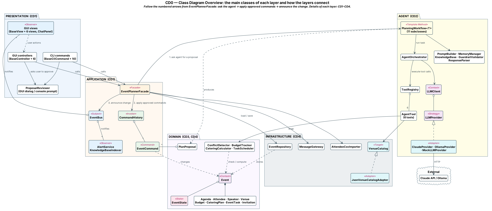

*Figure 2 — Main classes per layer. Follow the numbered arrows from `EventPlannerFacade`: (1) ask the agent for a proposal, (2) apply the approved commands, (3) announce the change.*

### 3.2 CD1 — Presentation and Application

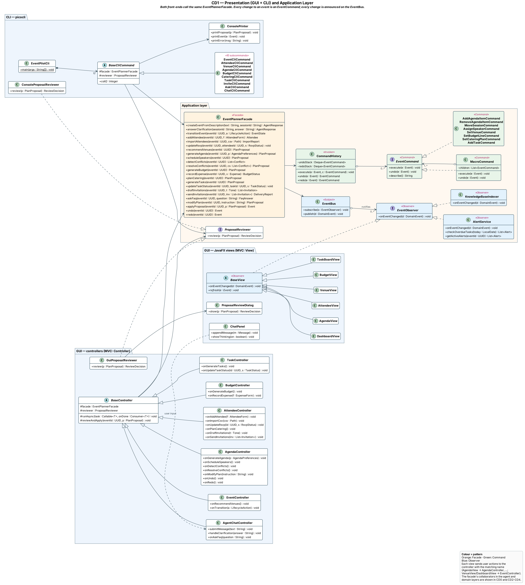

*Figure 3 — GUI views and controllers (MVC), the CLI, the facade, Command (`EventCommand`, `CommandHistory`, `MacroCommand`) and Observer (`EventBus`, `EventObserver`). Both front-ends depend only on `EventPlannerFacade` and the `ProposalReviewer` interface.*

### 3.3 CD2 — Agent Layer

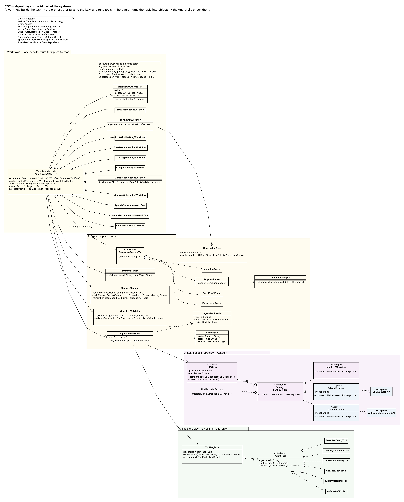

*Figure 4 — The AI components. `PlanningWorkflow<T>` fixes the steps of every AI feature; 11 subclasses fill in the details. `AgentOrchestrator` runs the tool loop. `LLMProvider` is the swappable model, and `ToolRegistry` holds the 6 tools.*

### 3.4 CD3 — Domain Model

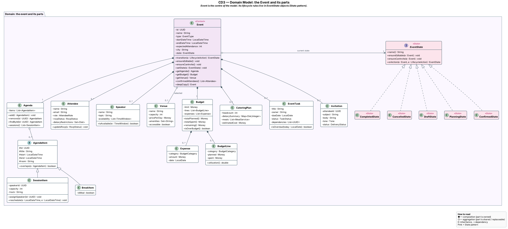

*Figure 5 — `Event` owns its agenda, attendees, speakers, budget, catering plan, tasks and invitations, and shares a `Venue` from the catalog. It delegates lifecycle rules to its current `EventState`.*

### 3.5 CD4 — Domain Services, Agent Results and Infrastructure

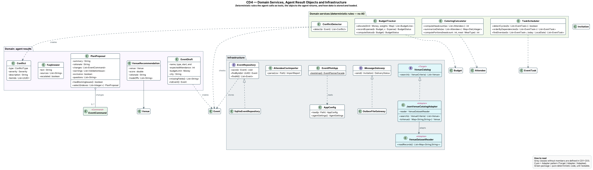

*Figure 6 — Deterministic rule engines (called by the agent's tools), the objects the agent returns, and storage and adapters.*

### 3.6 Key Classes and Responsibilities

| Class | Responsibility |
|---|---|
| `EventPlannerFacade` | The single entry point for every user goal; coordinates repository, workflows, commands and the event bus |
| `BaseController` / `BaseCliCommand` | Turn GUI events or CLI arguments into facade calls; `runAsync` keeps the GUI responsive during AI calls |
| `ProposalReviewer` | Interface for the human approval step (`GuiProposalReviewer` shows a dialog, `ConsoleProposalReviewer` prints a y/N prompt) |
| `EventCommand`, `MacroCommand`, `CommandHistory` | Represent each change as an object; execute, undo and redo |
| `EventBus`, `EventObserver` | Tell views, `AlertService` and `KnowledgeBaseIndexer` that an event changed |
| `PlanningWorkflow<T>` (+11) | Run one AI feature: context → prompt → agent → parse → validate |
| `AgentOrchestrator` | The agent loop: call the LLM, run requested tools, feed results back, stop after 8 steps |
| `LLMClient`, `LLMProvider` | Retries and time-outs; provider-specific API calls (Claude, Ollama, Mock) |
| `ToolRegistry`, `AgentTool` (+6) | Expose tools to the LLM, check arguments against a JSON schema, and run them (read-only) |
| `MemoryManager`, `KnowledgeBase` | Conversation and preference memory; searchable event information for the FAQ |
| `GuardrailValidator` | Deterministic checks on drafts and proposals |
| `ResponseParser<T>`, `CommandMapper` | Turn LLM JSON into domain objects or commands |
| `Event`, `EventState` (+5) | The event and its lifecycle rules |
| `ConflictDetector`, `BudgetTracker`, `CateringCalculator`, `TaskScheduler` | Rule engines (pure Java, easy to unit-test) |
| `EventRepository`, `VenueCatalog`, `MessageGateway`, `AttendeeCsvImporter`, `AppConfig` | Storage, venue data, e-mail, CSV import, configuration |

### 3.7 Important Relationships and Multiplicities

| Relationship | Kind | Multiplicity | Why |
|---|---|---|---|
| `Event` ◆ `Agenda`, `Budget` | Composition | 1 – 1 | Have no meaning without their event |
| `Event` ◆ `Attendee`, `Speaker`, `EventTask`, `Invitation` | Composition | 1 – 0..* | Owned by one event |
| `Event` ◇ `Venue` | Aggregation | 0..* – 0..1 | A venue exists in the catalog independently and can be reused |
| `Event` ◇ `EventState` | Aggregation | 1 – 1 | Exactly one current state, replaced on each transition |
| `Agenda` ◇ `AgendaItem` | Aggregation | 1 – 0..* | Items can be moved and removed |
| `MacroCommand` ◇ `EventCommand` | Aggregation | 1 – 1..* | One approved proposal = one undoable unit |
| `EventBus` ◇ `EventObserver` | Aggregation | 1 – 0..* | Observers subscribe at start-up |
| `LLMClient` ◇ `LLMProvider` | Aggregation | 1 – 1 | Provider can be replaced at run time |
| `ToolRegistry` ◇ `AgentTool` | Aggregation | 1 – 6 | Tools registered at start-up |
| `PlanningWorkflow` ⇢ `ResponseParser` | Dependency (creates) | — | Each workflow creates the parser for its output type |

**Design principles applied:** separation of concerns (UI, application, agent, domain, infrastructure); single responsibility (e.g. `ConflictDetector` only detects, `ConflictResolutionWorkflow` only proposes); open/closed (a new AI feature is a new workflow subclass, and a new model is a new provider); dependency inversion (the facade and workflows depend on interfaces such as `EventRepository`, `LLMProvider`, `VenueCatalog`, `MessageGateway` and `ProposalReviewer`, which `EventPilotApp.bootstrap()` wires to real or test implementations).

---

## 4. Design Pattern Explanations

Seven patterns are used. Each solves a specific problem in this system. MVC is used as the overall GUI architecture (views + controllers + model behind the facade) but is not counted among the seven.

| Pattern | Participating classes | Problem addressed | Features |
|---|---|---|---|
| Facade | `EventPlannerFacade` | Two front-ends, many subsystems | All |
| Command | `EventCommand`, concrete commands, `MacroCommand`, `CommandHistory` | Review AI changes before applying; undo/redo | F03–F09, F12 |
| Observer | `EventBus`, `EventObserver`, views, `AlertService`, `KnowledgeBaseIndexer` | Keep many parts in sync after a change | F02, F06, F07, F09, F11 |
| Strategy | `LLMClient`, `LLMProvider`, `ClaudeProvider`, `OllamaProvider`, `MockLLMProvider` | Swap AI models without code changes | All AI features |
| Template Method | `PlanningWorkflow<T>` + 11 subclasses | Same reliable steps for every AI feature | All AI features |
| State | `Event`, `EventState`, 5 state classes | What is allowed depends on the event's stage | F10, UC15, all editing |
| Adapter | `JsonVenueCatalogAdapter`, `ClaudeProvider`, `OllamaProvider` | External data and APIs have the wrong shape | F03, all AI features |

### P1 — Facade

* **Problem.** Each user goal touches many objects: the repository, a state check, a workflow, the guardrails, the command history and the event bus. The same goals must be available from both the GUI and the CLI. Without a single entry point, this coordination code would be copied into every controller and every CLI command.
* **Participants and roles.** `EventPlannerFacade` is the **facade**, with one method per user goal. The repository, workflows, `CommandHistory`, `EventBus`, `GuardrailValidator`, `ConflictDetector`, `BudgetTracker`, `TaskScheduler`, `AttendeeCsvImporter` and `MessageGateway` are the **subsystem** classes. The GUI controllers and CLI commands are the **clients**.
* **Why it fits.** The GUI and CLI get exactly the same small API, so the CLI is guaranteed to offer the same major functions as the GUI. The facade is also the natural place for the "load → change → save → notify" sequence.
* **Without it.** Duplicated logic in about 20 controller methods and 10 CLI commands, with an easy chance that the CLI forgets a step (for example, not re-validating before applying).

### P2 — Command

* **Problem.** AI changes must be **shown to the organizer before they happen**, it must be possible to accept only some of them, and every change must be **undoable**. The LLM's free-form answer must also be limited to a safe, fixed set of operations.
* **Participants and roles.** `EventCommand` is the **command** interface (`execute`, `undo`, `describe`). `AddAgendaItemCommand`, `RemoveAgendaItemCommand`, `MoveSessionCommand`, `AssignSpeakerCommand`, `SetVenueCommand`, `SetBudgetLineCommand`, `SetCateringPlanCommand` and `AddTaskCommand` are **concrete commands**; each stores what it needs to undo itself. `MacroCommand` groups an approved proposal. `CommandHistory` is the **invoker** that keeps the undo and redo stacks. `Event` is the **receiver**. `CommandMapper` and the facade are the **clients** that create commands.
* **Why it fits.** A proposal becomes a list of objects that can be displayed, selected, executed and undone. The AI can only request operations that exist as command classes.
* **Without it.** The agent would change the event directly, which is unsafe and impossible to review. Undo would need full copies of the event or custom reverse code for each feature.

### P3 — Observer

* **Problem.** One change, such as a moved session, must update several unrelated parts: the agenda and dashboard views, the alert service (are there new conflicts?), and the FAQ knowledge base (attendee answers must reflect the new time). The facade should not have to know about all of them.
* **Participants and roles.** `EventBus` is the **subject** (`subscribe`, `publish`). `EventObserver` is the **observer** interface. `BaseView` and its subclasses, `AlertService` and `KnowledgeBaseIndexer` are **concrete observers**. `DomainEvent` carries what changed.
* **Why it fits.** New listeners can be added without touching the facade, the views always show current data, and the FAQ never answers from stale information.
* **Without it.** The facade would call every view and service by hand. Forgetting one would cause stale screens, missed alerts or wrong FAQ answers, and the application layer would depend on JavaFX.

### P4 — Strategy

* **Problem.** The agent must work with different models: Claude for quality, Ollama for free offline use, and a scripted mock for tests. The model should be chosen by configuration.
* **Participants and roles.** `LLMClient` is the **context**; it holds a provider and adds retries and time-outs. `LLMProvider` is the **strategy** interface (`chat`). `ClaudeProvider`, `OllamaProvider` and `MockLLMProvider` are **concrete strategies**. `LLMProviderFactory` picks one from `AppConfig`.
* **Why it fits.** Workflows never know which model they use. Stage 3 tests can use the mock for repeatable results and a real model for behavior tests.
* **Without it.** `if (provider == "claude") … else …` in every LLM call; tests would always need the internet and would not be repeatable.

### P5 — Template Method

* **Problem.** Eleven AI features need the **same reliable procedure**: gather context → build prompt → run the agent → parse JSON → fix invalid JSON → validate → return. Only the prompt, the parser and some checks differ. Copying this procedure 11 times would lead to inconsistent error handling.
* **Participants and roles.** `PlanningWorkflow<T>` is the **abstract class**. Its `execute()` is `final` and defines the steps. `buildTask()` and `createParser()` are abstract; `gatherContext()` and `validate()` are hooks with default behavior. The 11 **concrete classes** (`EventExtractionWorkflow`, `VenueRecommendationWorkflow`, `AgendaGenerationWorkflow`, `SpeakerSchedulingWorkflow`, `ConflictResolutionWorkflow`, `BudgetPlanningWorkflow`, `CateringPlanningWorkflow`, `TaskDecompositionWorkflow`, `InvitationDraftingWorkflow`, `FaqAnswerWorkflow`, `PlanModificationWorkflow`) fill in the steps. For example, `FaqAnswerWorkflow` overrides `gatherContext()` to do retrieval, and `ConflictResolutionWorkflow` overrides `validate()` to test the fix on a copy.
* **Why it fits.** Safety features (repair retries, guardrails, tool trace) are written once and every AI feature gets them. A new AI feature only needs its prompt and parser.
* **Without it.** Eleven near-identical methods, where a bug fixed in one would stay broken in the others.

### P6 — State

* **Problem.** What the organizer may do depends on the event's stage. A *Draft* cannot send invitations; a *Completed* or *Cancelled* event is read-only; *Confirm* requires a venue and an agenda. Writing `if (status == …)` checks in every facade method would scatter these rules everywhere.
* **Participants and roles.** `Event` is the **context**; it holds the current state and forwards `ensureEditable()`, `ensureCanInvite()` and `transition()` to it. `EventState` is the **state** interface. `DraftState`, `PlanningState`, `ConfirmedState`, `CompletedState` and `CancelledState` are the **concrete states**; each knows its permissions and its allowed next states.
* **Why it fits.** Each stage's rules are in one class, transitions are explicit and easy to test, and a new stage (e.g. *Postponed*) is a new class.
* **Without it.** Large condition blocks repeated in many methods, with a real risk of, for example, sending invitations for a cancelled event.

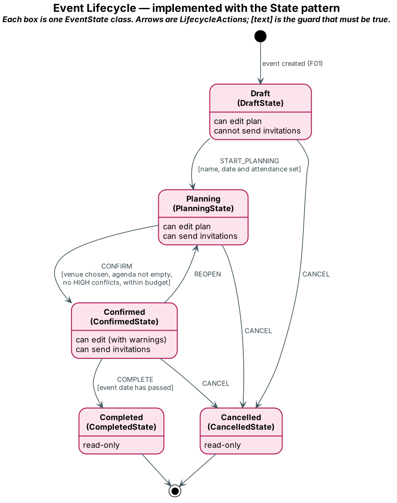

*Figure 7 — The event lifecycle implemented by the state classes.*

### P7 — Adapter

* **Problem.** External sources have their own formats. The venue dataset uses different field names than our `Venue` class, and the Anthropic and Ollama APIs each use their own request and response JSON. The rest of the system should see one stable interface.

**Participants and roles:**

| Target (what our code expects) | Adapter | Adaptee (what exists) |
|---|---|---|
| `VenueCatalog.search(criteria)` | `JsonVenueCatalogAdapter` | `VenueDatasetReader.readRecords()` |
| `LLMProvider.chat(request)` | `ClaudeProvider` | Anthropic Messages API |
| `LLMProvider.chat(request)` | `OllamaProvider` | Ollama REST API |

Clients: `VenueSearchTool`, `LLMClient`.

* **Why it fits.** Vendor formats are isolated in one class each. Replacing the venue dataset with a real venue API later means writing one new adapter.
* **Without it.** Vendor JSON handling would spread through tools and workflows, and an API change would break many classes.

---

## 5. Use-Case Diagram

The diagram is shown in two views to keep it readable. View 1 shows the people who use the system and every use case. View 2 shows the external systems the use cases depend on.

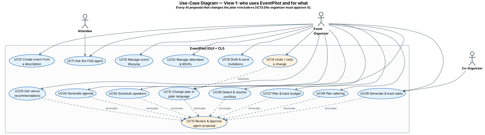

*Figure 8 — View 1: human actors, all 15 use cases, «include» and «extend».*

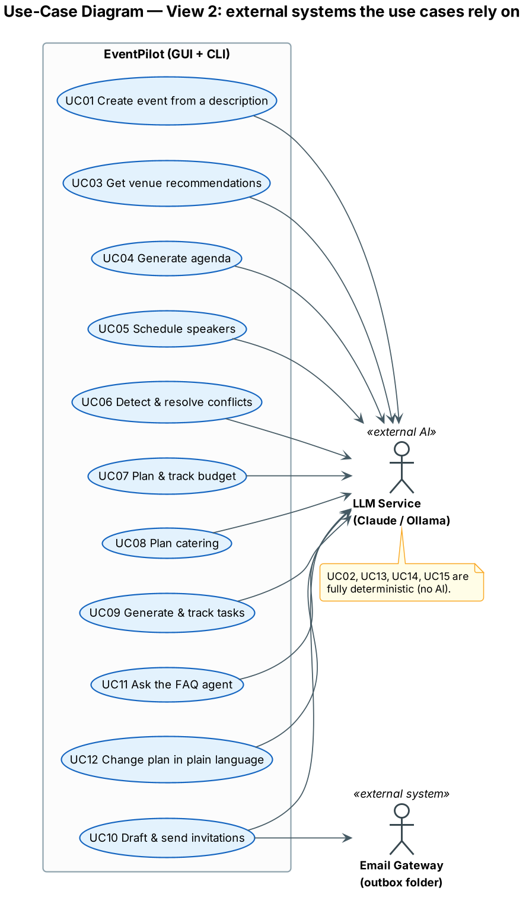

*Figure 9 — View 2: external actors (LLM service, e-mail gateway).*

**Actors**

| Actor | Type | Role |
|---|---|---|
| Event Organizer | Primary | Plans the event, reviews and approves agent proposals |
| Attendee | Secondary | Asks questions through the FAQ agent |
| Co-Organizer | Secondary | Updates tasks assigned to them |
| LLM Service (Claude / Ollama) | External AI | Reasoning, planning, tool selection, text generation |
| Email Gateway (outbox folder) | External system | Delivers invitations |

**Relationships:** UC03–UC09 and UC12 «include» **UC13 Review & approve agent proposal**, because no AI change is applied without approval. **UC14 Undo/redo** «extend»s UC12 (and can be used after any applied change).

**Feature coverage:** UC01–UC12 correspond one-to-one to F01–F12. UC13, UC14 and UC15 are supporting use cases (approval, undo, lifecycle).

---

## 6. Detailed Use-Case Descriptions

**Shared precondition (P0):** EventPilot is running (GUI or CLI) and the database is available. **Shared exception (E-AI):** for AI use cases, if the LLM cannot be reached after 3 retries, the user is told that the AI is unavailable, nothing changes, and a manual alternative is offered where one exists.

### UC01 — Create Event from a Description

| Field | Description |
|---|---|
| **Use Case ID** | UC01 |
| **Use Case Name** | Create Event from a Description |
| **Actor(s)** | Primary: Event Organizer; Supporting: LLM Service |
| **Goal** | Create a correctly specified event without filling a long form |
| **Preconditions** | P0 |
| **Trigger** | Organizer types a description in the chat (or `event create "<text>"`) |
| **Main Success Scenario** | 1. Organizer enters the description. 2. System asks the agent to extract the event details. 3. System validates the result. 4. All required details are present. 5. System creates the event in *Draft*, saves it and shows it on the Dashboard. 6. System confirms with a summary. |
| **Alternative / Exception Flows** | 4a. Details missing or contradictory → system asks follow-up questions; organizer answers; continue at step 2. 3a. Agent output invalid → system asks the agent to correct it (max 2). 1a. Not an event request → system explains what it can do. E-AI → manual *New Event* form. |
| **Postconditions** | A new event exists in Draft state (or nothing is created). |
| **Related Feature** | F01 |

### UC02 — Manage Attendees & RSVPs

| Field | Description |
|---|---|
| **Use Case ID** | UC02 |
| **Use Case Name** | Manage Attendees & RSVPs |
| **Actor(s)** | Primary: Event Organizer |
| **Goal** | Keep an accurate attendee list with roles, diets and RSVP status |
| **Preconditions** | P0; event exists and is not Completed/Cancelled |
| **Trigger** | Organizer adds an attendee, imports a CSV, or changes an RSVP |
| **Main Success Scenario** | 1. Organizer chooses *Import CSV* and a file. 2. System checks every row. 3. System adds the valid, non-duplicate attendees. 4. System saves and refreshes the views. 5. System shows the import report. 6. Organizer changes an RSVP; system saves and updates the counts. |
| **Alternative / Exception Flows** | 1a. Manual add through the form. 2a. File missing or wrong header → error, nothing imported. 2b. Some rows invalid → those rows are listed; the rest import. 3a. Duplicate e-mail → skipped and reported. |
| **Postconditions** | Attendee list and RSVP counts are up to date; FAQ data refreshed. |
| **Related Feature** | F02 |

### UC03 — Get Venue Recommendations

| Field | Description |
|---|---|
| **Use Case ID** | UC03 |
| **Use Case Name** | Get Venue Recommendations |
| **Actor(s)** | Primary: Event Organizer; Supporting: LLM Service |
| **Goal** | Choose a venue that fits capacity, budget, location and accessibility |
| **Preconditions** | P0; event is editable and has an attendance estimate |
| **Trigger** | Organizer clicks *Recommend venues* (or `venue recommend`) |
| **Main Success Scenario** | 1. Organizer asks for recommendations. 2. Agent searches the venue catalog with the venue tool. 3. Agent checks the venue budget with the budget tool. 4. Agent ranks up to three venues with reasons and trade-offs. 5. System validates them. 6. «include» UC13: organizer picks one. 7. System sets the venue and saves. |
| **Alternative / Exception Flows** | 2a. Invalid tool arguments → returned to the agent to correct. 2b. No match → agent relaxes only price or district and says so; otherwise reports "no suitable venue". 5a. Venue not from the catalog or too small → blocked. 6a. Organizer rejects → no change. E-AI. |
| **Postconditions** | Venue selected (undoable), or unchanged. |
| **Related Feature** | F03 |

### UC04 — Generate Agenda

| Field | Description |
|---|---|
| **Use Case ID** | UC04 |
| **Use Case Name** | Generate Agenda |
| **Actor(s)** | Primary: Event Organizer; Supporting: LLM Service |
| **Goal** | Get a complete agenda without conflicts that matches the organizer's preferences |
| **Preconditions** | P0; event editable; event hours set |
| **Trigger** | Organizer clicks *Generate agenda* and confirms preferences |
| **Main Success Scenario** | 1. Organizer sets preferences. 2. Agent drafts the agenda, checking it with the conflict tool. 3. System converts the draft to commands and validates them. 4. «include» UC13. 5. System applies the changes as one undoable step, saves and notifies. |
| **Alternative / Exception Flows** | 1a. Agenda already exists → choose replace or extend. 3a. Items outside event hours or overlapping → warnings; serious ones block approval. 4a. Rejected → no change. E-AI. |
| **Postconditions** | Agenda saved; change can be undone. |
| **Related Feature** | F04 |

### UC05 — Schedule Speakers

| Field | Description |
|---|---|
| **Use Case ID** | UC05 |
| **Use Case Name** | Schedule Speakers |
| **Actor(s)** | Primary: Event Organizer; Supporting: LLM Service |
| **Goal** | Place every speaker in a session they are available for, with no double-booking |
| **Preconditions** | P0; event editable; speakers and sessions exist |
| **Trigger** | Organizer clicks *Auto-schedule speakers* |
| **Main Success Scenario** | 1. Organizer requests scheduling. 2. Agent reads speaker availability with the availability tool. 3. Agent proposes assignments and checks them with the conflict tool until no serious conflict remains. 4. System validates. 5. «include» UC13. 6. System applies and saves. |
| **Alternative / Exception Flows** | 1a. No speakers or sessions → error before any AI call. 3a. Impossible constraints → proposal for the speakers that fit, plus an explanation. E-AI. |
| **Postconditions** | Speakers assigned (undoable). |
| **Related Feature** | F05 |

### UC06 — Detect & Resolve Conflicts

| Field | Description |
|---|---|
| **Use Case ID** | UC06 |
| **Use Case Name** | Detect & Resolve Conflicts |
| **Actor(s)** | Primary: Event Organizer; Supporting: LLM Service |
| **Goal** | Find all scheduling problems and fix them with as few changes as possible |
| **Preconditions** | P0; event exists |
| **Trigger** | Organizer clicks *Check conflicts* (also runs automatically after every change) |
| **Main Success Scenario** | 1. System runs the conflict detector. 2. System lists and highlights conflicts. 3. Organizer clicks *Ask agent to fix*. 4. Agent proposes changes. 5. System tests the fix on a copy of the event. 6. «include» UC13. 7. System applies the fix. |
| **Alternative / Exception Flows** | 2a. No conflicts → "No conflicts found". 5a. Fix creates new conflicts → blocked and retried once; then the remaining conflicts are listed for manual fixing. E-AI → detection still works (no AI needed). |
| **Postconditions** | Conflicts shown; if approved, resolved. |
| **Related Feature** | F06 |

### UC07 — Plan & Track Budget

| Field | Description |
|---|---|
| **Use Case ID** | UC07 |
| **Use Case Name** | Plan & Track Budget |
| **Actor(s)** | Primary: Event Organizer; Supporting: LLM Service |
| **Goal** | Split the budget sensibly and stay within it |
| **Preconditions** | P0; event has a budget limit |
| **Trigger** | Organizer clicks *Generate budget plan* or records an expense |
| **Main Success Scenario** | 1. Organizer asks for a plan. 2. Agent chooses the split; the budget tool calculates the amounts. 3. System checks the total does not exceed the limit. 4. «include» UC13. 5. Organizer records an expense. 6. System validates it, updates totals and saves. 7. Alert service checks spending. |
| **Alternative / Exception Flows** | 1a. No limit → organizer asked to set one. 6a. Invalid amount or category → form error. 7a. Category over plan or ≥ 90 % spent → alert on the Dashboard. E-AI (planning only; tracking still works). |
| **Postconditions** | Budget lines, expenses and alerts up to date. |
| **Related Feature** | F07 |

### UC08 — Plan Catering

| Field | Description |
|---|---|
| **Use Case ID** | UC08 |
| **Use Case Name** | Plan Catering |
| **Actor(s)** | Primary: Event Organizer; Supporting: LLM Service |
| **Goal** | A catering plan that fits the headcount, covers every diet and stays within budget |
| **Preconditions** | P0; event editable; attendees exist |
| **Trigger** | Organizer clicks *Plan catering* |
| **Main Success Scenario** | 1. System computes headcount and dietary counts. 2. Agent designs meals and menus; the catering tool computes portions. 3. System checks diets are covered and cost fits. 4. «include» UC13. 5. System saves the plan. |
| **Alternative / Exception Flows** | 1a. No RSVPs yet → expected attendance used, with a warning. 3a. A diet not covered → blocked, retried once. 3b. Over budget → warning. E-AI. |
| **Postconditions** | Catering plan saved; FAQ can answer food questions. |
| **Related Feature** | F08 |

### UC09 — Generate & Track Tasks

| Field | Description |
|---|---|
| **Use Case ID** | UC09 |
| **Use Case Name** | Generate & Track Tasks |
| **Actor(s)** | Primary: Event Organizer; Secondary: Co-Organizer; Supporting: LLM Service |
| **Goal** | A complete, correctly ordered task list that stays up to date |
| **Preconditions** | P0; event has a date |
| **Trigger** | Organizer clicks *Generate task plan*; co-organizer moves a task card |
| **Main Success Scenario** | 1. Organizer requests a task plan. 2. Agent lists tasks with owners, deadlines and dependencies. 3. System checks for circular dependencies and orders the tasks. 4. «include» UC13. 5. Co-organizer marks a task done. 6. System checks its dependencies are done and saves. |
| **Alternative / Exception Flows** | 3a. Cycle or deadline after the event → blocked, retried once. 6a. Dependency not done → refused ("blocked by …"). Overdue tasks → alert at start-up and every morning. |
| **Postconditions** | Tasks and statuses saved; overdue alerts current. |
| **Related Feature** | F09 |

### UC10 — Draft & Send Invitations

| Field | Description |
|---|---|
| **Use Case ID** | UC10 |
| **Use Case Name** | Draft & Send Invitations |
| **Actor(s)** | Primary: Event Organizer; Supporting: LLM Service, Email Gateway |
| **Goal** | Send correct, personalised invitations |
| **Preconditions** | P0; event in *Planning* or *Confirmed*; attendees exist |
| **Trigger** | Organizer chooses a tone and clicks *Draft invitations* |
| **Main Success Scenario** | 1. System checks the event state allows invitations. 2. Agent drafts one template per attendee group. 3. System checks each contains the real date, time and venue. 4. Organizer edits and clicks *Send*. 5. System sends each invitation through the gateway. 6. System shows the delivery report. |
| **Alternative / Exception Flows** | 1a. Wrong state → refused with guidance. 3a. Wrong or missing facts → regenerated. 5a. One delivery fails → recorded; the rest continue. E-AI → organizer can write the text manually. |
| **Postconditions** | Invitations recorded with delivery status. |
| **Related Feature** | F10 |

### UC11 — Ask the FAQ Agent

| Field | Description |
|---|---|
| **Use Case ID** | UC11 |
| **Use Case Name** | Ask the FAQ Agent |
| **Actor(s)** | Primary: Attendee (or Organizer); Supporting: LLM Service |
| **Goal** | Get a correct, sourced answer about the event |
| **Preconditions** | P0; event information is indexed |
| **Trigger** | User asks a question in FAQ mode (or `ask "<question>"`) |
| **Main Success Scenario** | 1. User asks a question. 2. System finds the 5 most relevant pieces of event information. 3. Agent answers only from them and cites them. 4. System checks the cited sources were retrieved. 5. System shows the answer with sources. |
| **Alternative / Exception Flows** | 2a. Nothing relevant → "forwarded to the organizer" plus an organizer alert. 4a. Unknown source cited → safe reply, escalated. 1a. Off-topic or manipulation attempt → declined. |
| **Postconditions** | Answer shown, or question escalated. |
| **Related Feature** | F11 |

### UC12 — Change Plan in Plain Language

| Field | Description |
|---|---|
| **Use Case ID** | UC12 |
| **Use Case Name** | Change Plan in Plain Language |
| **Actor(s)** | Primary: Event Organizer; Supporting: LLM Service |
| **Goal** | Change the plan by describing the change |
| **Preconditions** | P0; event editable |
| **Trigger** | Organizer types an instruction (or `agenda modify "<text>"`) |
| **Main Success Scenario** | 1. Organizer enters the instruction. 2. Agent maps it to operations on real items. 3. System turns the operations into commands and validates them. 4. «include» UC13. 5. System applies them as one undoable step. |
| **Alternative / Exception Flows** | 2a. Ambiguous → agent asks which item. 3a. Unknown item or operation → agent asked to fix it. 5a. Organizer reverts → «extend» UC14. E-AI. |
| **Postconditions** | Plan changed (undoable), or unchanged. |
| **Related Feature** | F12 |

### UC13 — Review & Approve Agent Proposal (included)

| Field | Description |
|---|---|
| **Use Case ID** | UC13 |
| **Use Case Name** | Review & Approve Agent Proposal |
| **Actor(s)** | Primary: Event Organizer |
| **Goal** | Keep the organizer in control of every AI change |
| **Preconditions** | A workflow has produced a `PlanProposal` |
| **Trigger** | Included by UC03–UC09 and UC12 |
| **Main Success Scenario** | 1. System shows the changes, reasons and warnings. 2. Organizer approves all. 3. System re-checks the proposal against the current event. 4. System applies all changes as one undoable step, saves and notifies. |
| **Alternative / Exception Flows** | 2a. Approve selected (or pick one of several alternatives). 2b. Reject → nothing changes. 3a. A blocking problem appears (e.g. the event changed meanwhile) → refused with reasons. CLI: printed list and a `[y/N/select]` prompt. |
| **Postconditions** | Changes applied, or event unchanged. |
| **Related Feature** | F03–F09, F12 |

### UC14 — Undo / Redo a Change

| Field | Description |
|---|---|
| **Use Case ID** | UC14 |
| **Use Case Name** | Undo / Redo a Change |
| **Actor(s)** | Primary: Event Organizer |
| **Goal** | Reverse (or re-apply) the latest change |
| **Preconditions** | P0; event editable; at least one change in the history |
| **Trigger** | *Undo* / *Redo* button, Ctrl+Z / Ctrl+Y, or `agenda undo` / `agenda redo` |
| **Main Success Scenario** | 1. Organizer clicks *Undo*. 2. System undoes the last change (all its steps, in reverse order). 3. System saves and refreshes, showing "Undid: …". |
| **Alternative / Exception Flows** | 2a. Nothing to undo → message. Redo works the same way in the other direction. A new change after undo clears the redo history. |
| **Postconditions** | Event restored to its previous state. |
| **Related Feature** | F12 (and any applied proposal) |

### UC15 — Manage Event Lifecycle

| Field | Description |
|---|---|
| **Use Case ID** | UC15 |
| **Use Case Name** | Manage Event Lifecycle |
| **Actor(s)** | Primary: Event Organizer |
| **Goal** | Move the event through Draft → Planning → Confirmed → Completed (or Cancelled) |
| **Preconditions** | P0; event exists |
| **Trigger** | Organizer clicks *Start planning*, *Confirm*, *Reopen*, *Complete* or *Cancel* |
| **Main Success Scenario** | 1. Organizer clicks *Confirm*. 2. System checks there are no serious conflicts and the event is within budget. 3. The current state checks its own rule (venue chosen, agenda not empty). 4. The event moves to *Confirmed*; system saves and updates the badge. |
| **Alternative / Exception Flows** | 2a/3a. Check fails, or the move is not allowed from this state → refused with reasons. Cancel → asks for confirmation first. |
| **Postconditions** | Event in its new state; allowed actions change (e.g. invitations become possible). |
| **Related Feature** | Enables F10 and controls editing in all features |

---

## 7. Sequence Diagrams

Ten sequence diagrams cover all important behaviors. Each one uses the classes and methods of the class diagram. Each one is a UMLet all-in-one sequence diagram: lifelines are ordered from the user interface on the left to the agent, domain and external services on the right, the messages are numbered, and `alt` / `opt` / `loop` fragments show alternative and error flows. The tool loop (SD02) and the review-and-apply sequence (SD03, Part 2) are shown in full once; the other diagrams refer to them.

| SD | Shows | Features | Use cases |
|---|---|---|---|
| SD01 | Create event from a description | F01 | UC01 |
| SD02 | Venue recommendation — **the agent tool loop** | F03 | UC03 |
| SD03 | Agenda generation + **review & apply** | F04 | UC04, UC13 |
| SD04 | Speaker scheduling, conflict detection & resolution | F05, F06 | UC05, UC06 |
| SD05 | Budget plan, expenses and alerts | F07 | UC07 |
| SD06 | Attendee import, RSVP, catering plan | F02, F08 | UC02, UC08 |
| SD07 | Task plan, updates, overdue alerts | F09 | UC09 |
| SD08 | Lifecycle change + invitations (**State pattern**) | F10 | UC15, UC10 |
| SD09 | FAQ agent with retrieval | F11 | UC11 |
| SD10 | Plain-language change + undo, **from the CLI** | F12 | UC12, UC14 |

### SD01 — Create Event from a Description

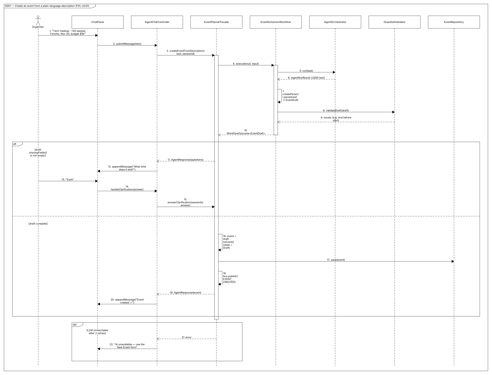

*Figure 10.* The facade runs `EventExtractionWorkflow`, which uses the agent, parses the reply into an `EventDraft` and validates it. If information is missing, the organizer is asked and the steps repeat. Otherwise the event is created in Draft state and saved. The `opt` fragment shows what happens when the AI is unavailable.

### SD02 — Venue Recommendation: the Agent Tool Loop

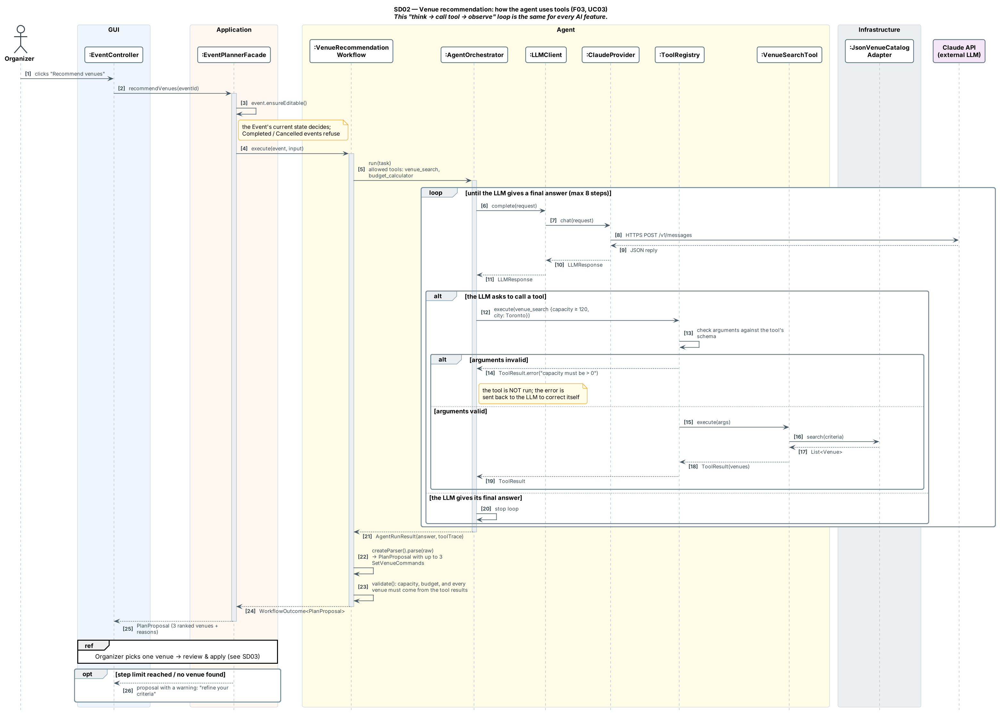

*Figure 11.* This diagram shows how the agent works. Inside the loop, the LLM either requests a tool or gives its final answer. `ToolRegistry` checks the arguments **before** running a tool; invalid arguments are sent back to the LLM without running anything. `VenueSearchTool` uses the venue adapter. The final answer is parsed into a proposal and validated: a venue the tool never returned is rejected.

### SD03 — Agenda Generation, then Review & Apply

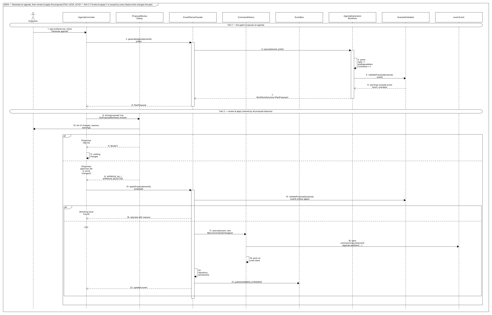

*Figure 12.* Part 1: the agent proposes `AddAgendaItemCommand`s. Part 2 (used by every proposal feature): the dialog shows the proposal; on approval the facade re-checks it, `CommandHistory` executes one `MacroCommand`, the event is saved, and `EventBus` notifies the views, `AlertService` and `KnowledgeBaseIndexer`.

### SD04 — Speakers and Conflicts

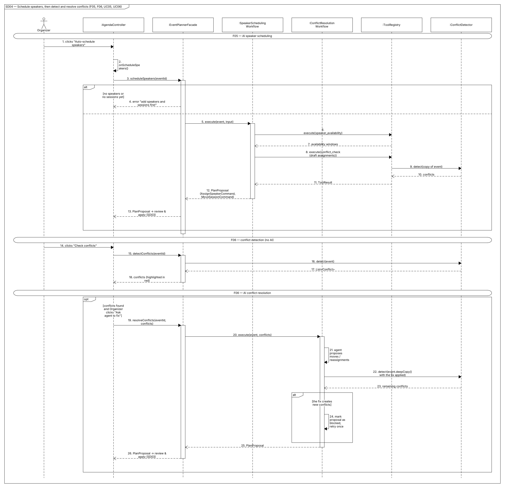

*Figure 13.* Scheduling uses the availability and conflict tools in a loop. Detection is plain code (`ConflictDetector.detect`). Resolution is proposed by the agent and tested on `event.deepCopy()`, so a fix that creates new conflicts is blocked.

### SD05 — Budget and Alerts

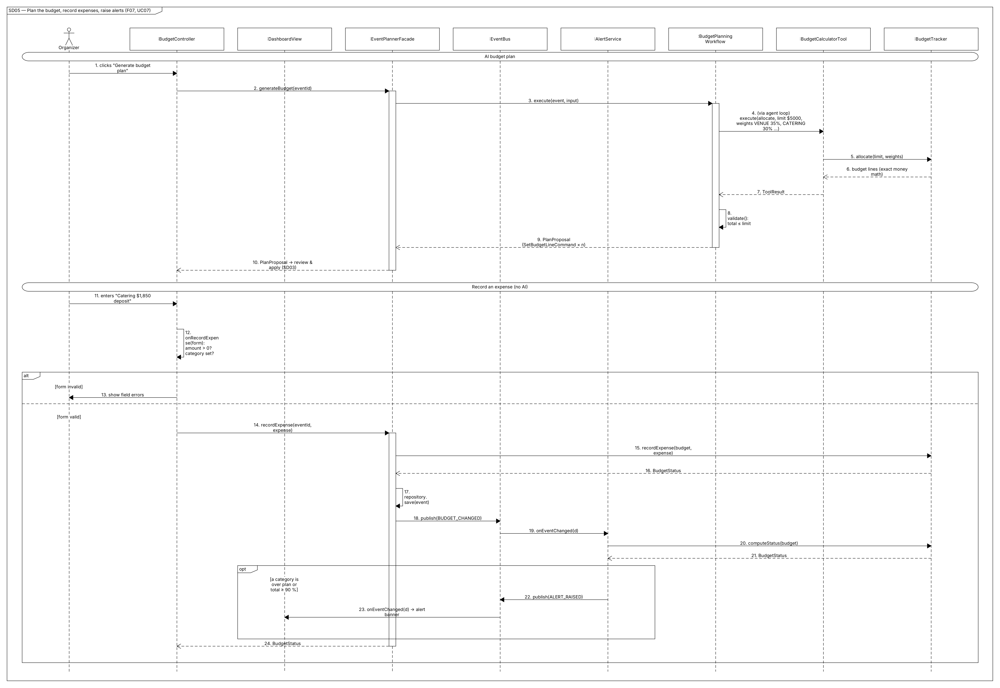

*Figure 14.* The LLM chooses the split, but `BudgetTracker.allocate()` does the math. Recording an expense is deterministic. `AlertService`, an observer, raises an alert that reaches the Dashboard through the bus.

### SD06 — Attendees and Catering

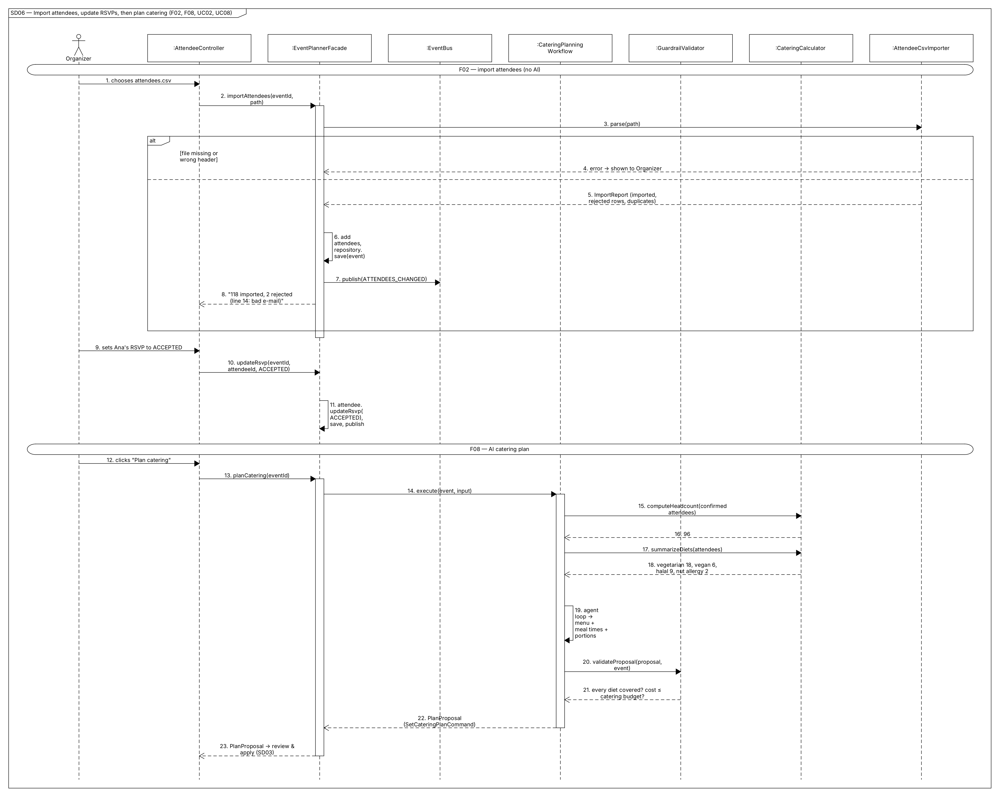

*Figure 15.* The CSV import validates each row and reports problems. For catering, the headcount and dietary counts are computed by `CateringCalculator` and given to the agent as facts. The guardrails check that every diet is covered and the cost fits.

### SD07 — Tasks

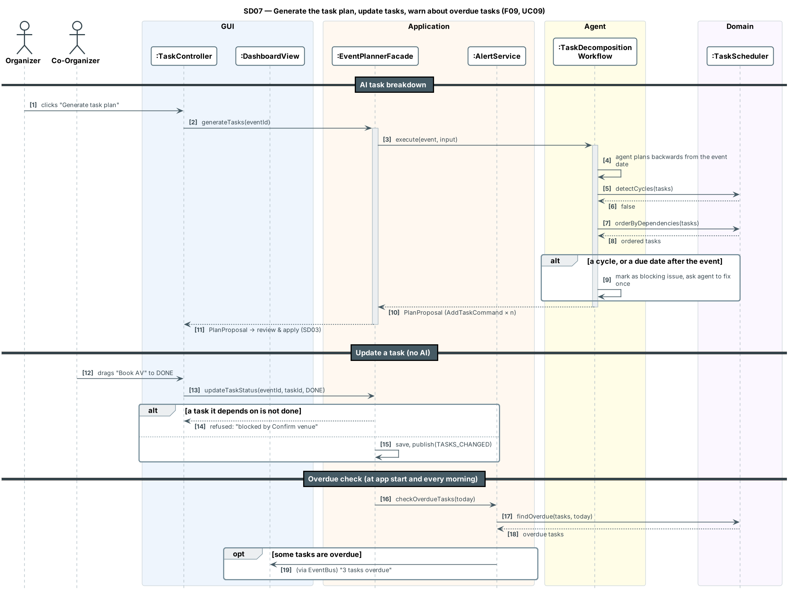

*Figure 16.* The agent's task list is checked by `TaskScheduler` (cycles, ordering). A status change is refused if a dependency is not finished. The overdue check runs at start-up and every morning.

### SD08 — Lifecycle Change and Invitations (State Pattern)

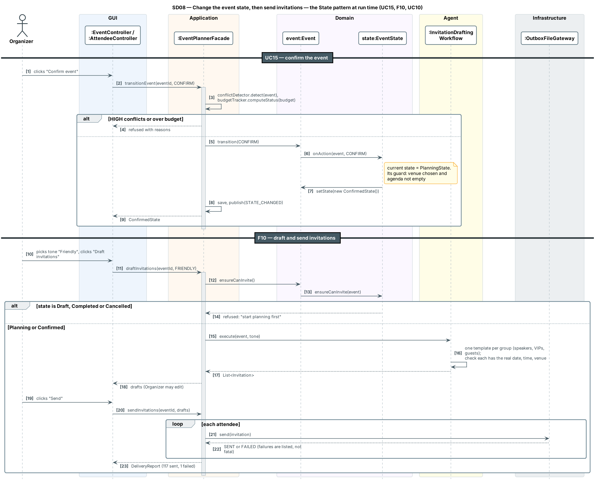

*Figure 17.* `Event.transition(CONFIRM)` is handled by the current state object (`PlanningState`), which checks its rule and installs a new `ConfirmedState`. Later, `ensureCanInvite()` is again answered by the state object. Sending continues even if one delivery fails.

### SD09 — FAQ Agent with Retrieval

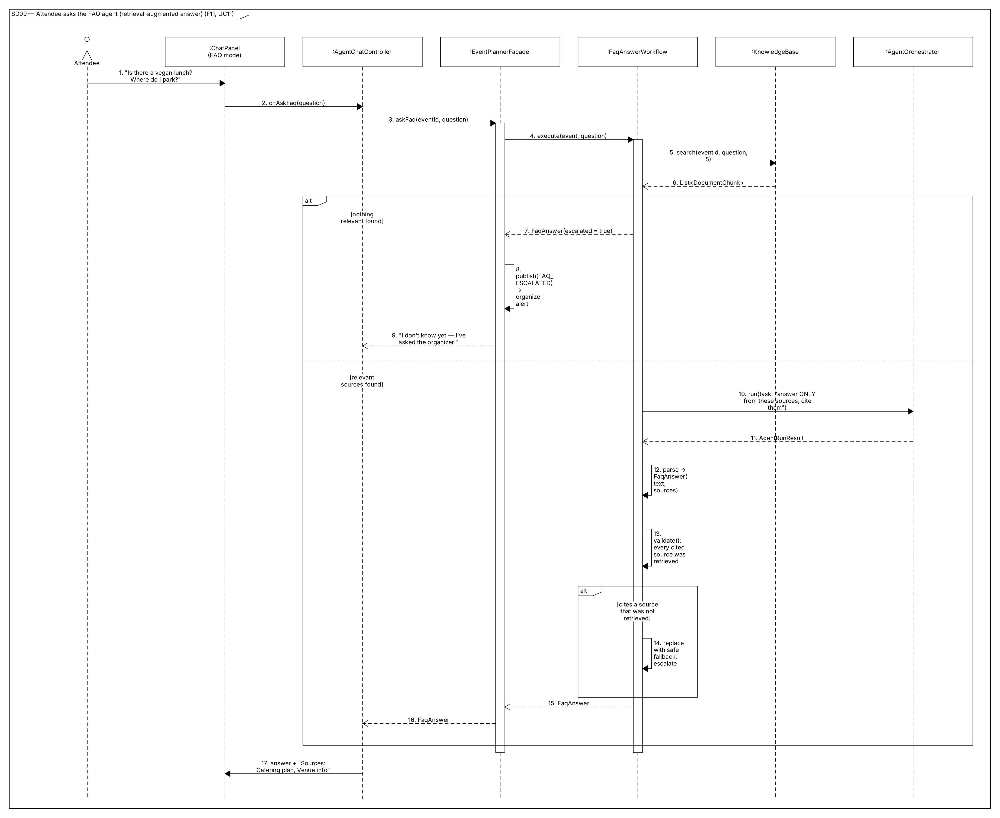

*Figure 18.* `KnowledgeBase.search()` finds relevant event information. If nothing is relevant, the question is escalated **without** asking the LLM. Otherwise the LLM may answer only from the sources, and the cited sources are checked.

### SD10 — Plain-Language Change and Undo from the CLI

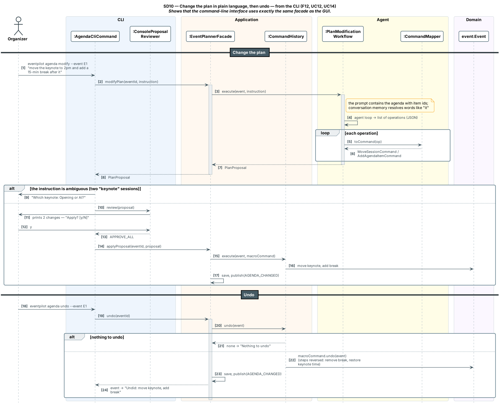

*Figure 19.* The CLI calls the same facade methods as the GUI. `CommandMapper` turns each operation into a typed command; `ConsoleProposalReviewer` asks `y/N`. Undo calls `MacroCommand.undo()`, which reverses the steps in the opposite order.

---

## 8. Feature-to-Design Traceability Table

| Feature | Description | Type | Use Case | Classes | Key Methods | Sequence Diagram | Design Pattern(s) |
|---|---|---|---|---|---|---|---|
| **F01** | Create event from a description | AI + validation | UC01 | `ChatPanel`, `AgentChatController`, `EventPlannerFacade`, `EventExtractionWorkflow`, `AgentOrchestrator`, `EventDraftParser`, `GuardrailValidator`, `EventDraft`, `Event`, `EventRepository` | `submitMessage()`, `createEventFromDescription()`, `answerClarification()`, `execute()`, `run()`, `parse()`, `validateDraft()`, `missingFields()`, `toEvent()`, `save()` | SD01 | Facade, Template Method, Strategy |
| **F02** | Attendee & RSVP management | Deterministic | UC02 | `AttendeeView`, `AttendeeController`, `EventPlannerFacade`, `AttendeeCsvImporter`, `Attendee`, `EventBus`, `KnowledgeBaseIndexer` | `onImportCsv()`, `onUpdateRsvp()`, `importAttendees()`, `updateRsvp()`, `parse()`, `Attendee.updateRsvp()`, `publish()` | SD06 | Facade, Observer, State (edit check) |
| **F03** | Venue recommendation | Hybrid | UC03, UC13 | `VenueView`, `EventController`, `EventPlannerFacade`, `VenueRecommendationWorkflow`, `AgentOrchestrator`, `LLMClient`, `ToolRegistry`, `VenueSearchTool`, `JsonVenueCatalogAdapter`, `GuardrailValidator`, `SetVenueCommand` | `onRecommendVenues()`, `recommendVenues()`, `ensureEditable()`, `run()`, `complete()`, `ToolRegistry.execute()`, `search()`, `validateProposal()`, `applyProposal()` | SD02 | Template Method, Strategy, Adapter, Command, State |
| **F04** | Agenda generation | Hybrid | UC04, UC13 | `AgendaView`, `AgendaController`, `ProposalReviewDialog`, `GuiProposalReviewer`, `EventPlannerFacade`, `AgendaGenerationWorkflow`, `ProposalParser`, `CommandMapper`, `GuardrailValidator`, `CommandHistory`, `MacroCommand`, `AddAgendaItemCommand`, `Agenda`, `EventBus` | `onGenerateAgenda()`, `generateAgenda()`, `toCommand()`, `validateProposal()`, `review()`, `show()`, `applyProposal()`, `CommandHistory.execute()`, `Agenda.add()`, `publish()` | SD03 | Template Method, Command, Observer, Facade |
| **F05** | Speaker scheduling | Hybrid | UC05, UC13 | `AgendaController`, `EventPlannerFacade`, `SpeakerSchedulingWorkflow`, `ToolRegistry`, `SpeakerAvailabilityTool`, `ConflictCheckTool`, `ConflictDetector`, `AssignSpeakerCommand`, `MoveSessionCommand`, `Speaker` | `onScheduleSpeakers()`, `scheduleSpeakers()`, `ToolRegistry.execute()`, `isAvailable()`, `detect()`, `assignSpeaker()`, `reschedule()` | SD04 | Template Method, Command |
| **F06** | Conflict detection & resolution | Hybrid | UC06, UC13 | `AgendaView`, `AgendaController`, `EventPlannerFacade`, `ConflictDetector`, `Conflict`, `ConflictResolutionWorkflow`, `Event`, `AlertService` | `onDetectConflicts()`, `detectConflicts()`, `detect()`, `onResolveConflicts()`, `resolveConflicts()`, `validate()`, `deepCopy()` | SD04 | Template Method, Command, Observer |
| **F07** | Budget planning & tracking | Hybrid | UC07, UC13 | `BudgetView`, `BudgetController`, `EventPlannerFacade`, `BudgetPlanningWorkflow`, `BudgetCalculatorTool`, `BudgetTracker`, `SetBudgetLineCommand`, `Budget`, `EventBus`, `AlertService`, `DashboardView` | `onGenerateBudget()`, `generateBudget()`, `allocate()`, `onRecordExpense()`, `recordExpense()`, `computeStatus()`, `onEventChanged()` | SD05 | Template Method, Command, Observer |
| **F08** | Catering plan | Hybrid | UC08, UC13 | `AttendeeController`, `EventPlannerFacade`, `CateringPlanningWorkflow`, `CateringCalculator`, `CateringCalculatorTool`, `GuardrailValidator`, `SetCateringPlanCommand`, `CateringPlan` | `onPlanCatering()`, `planCatering()`, `computeHeadcount()`, `summarizeDiets()`, `computePortions()`, `validateProposal()` | SD06 | Template Method, Command |
| **F09** | Task plan & tracking | Hybrid | UC09, UC13 | `TaskBoardView`, `TaskController`, `EventPlannerFacade`, `TaskDecompositionWorkflow`, `TaskScheduler`, `AddTaskCommand`, `EventTask`, `AlertService` | `onGenerateTasks()`, `generateTasks()`, `detectCycles()`, `orderByDependencies()`, `onUpdateTaskStatus()`, `updateTaskStatus()`, `checkOverdueTasks()`, `findOverdue()` | SD07 | Template Method, Command, Observer |
| **F10** | Invitations | AI + delivery | UC10, UC15 | `AttendeeController`, `EventController`, `EventPlannerFacade`, `Event`, `EventState`, `PlanningState`, `ConfirmedState`, `InvitationDraftingWorkflow`, `InvitationParser`, `Invitation`, `MessageGateway`, `OutboxFileGateway` | `onDraftInvitations()`, `draftInvitations()`, `ensureCanInvite()`, `onSendInvitations()`, `sendInvitations()`, `send()`, `transitionEvent()`, `transition()`, `onAction()`, `setState()` | SD08 | **State**, Template Method, Facade |
| **F11** | FAQ agent (RAG) | AI | UC11 | `ChatPanel`, `AgentChatController`, `EventPlannerFacade`, `FaqAnswerWorkflow`, `KnowledgeBase`, `AgentOrchestrator`, `FaqAnswerParser`, `FaqAnswer`, `KnowledgeBaseIndexer` | `onAskFaq()`, `askFaq()`, `gatherContext()`, `search()`, `index()`, `run()`, `parse()`, `validate()` | SD09 | Template Method, Observer, Strategy |
| **F12** | Plain-language changes + undo/redo | Hybrid | UC12, UC13, UC14 | `AgendaCliCommand`, `ConsoleProposalReviewer`, `AgendaController`, `EventPlannerFacade`, `PlanModificationWorkflow`, `CommandMapper`, `CommandHistory`, `MacroCommand`, `MoveSessionCommand`, `AddAgendaItemCommand` | `call()`, `onModifyPlan()`, `modifyPlan()`, `toCommand()`, `review()`, `applyProposal()`, `undo()`, `redo()`, `MacroCommand.undo()` | SD10 | **Command**, Template Method, Facade |

**Supporting use cases:** UC13 Review & approve → `ProposalReviewer`, `GuiProposalReviewer`, `ConsoleProposalReviewer`, `ProposalReviewDialog`, `CommandHistory` (SD03 Part 2). UC14 Undo/redo → `CommandHistory.undo()/redo()` (SD10). UC15 Lifecycle → `Event.transition()`, `EventState.onAction()` (SD08).

---

## 9. Feature Implementation Explanations

Each feature is explained in the same format: related use case, related sequence diagram, the classes involved and what each one is responsible for, the important methods, and how they work together at run time.

Every feature that changes the plan ends with the same **review & apply** step, shown in SD03 Part 2. The calls are: `BaseController.reviewAndApply()` → `ProposalReviewer.review()` → `EventPlannerFacade.applyProposal()` → `GuardrailValidator.validateProposal()` → `CommandHistory.execute()` with a `MacroCommand` → `EventRepository.save()` → `EventBus.publish()`. The explanations below refer to this step instead of repeating it.

### F01 — Create Event from a Description

**Related Use Case:** UC01 — Create Event from a Description\
**Related Sequence Diagram:** SD01 — Create an event from a plain-language description

**Classes involved:**

* `ChatPanel` — collects the organizer's text and shows the agent's replies.
* `AgentChatController` — sends the message to the facade in the background, so the GUI stays responsive, and handles follow-up answers.
* `EventPlannerFacade` — coordinates the request and saves the result.
* `EventExtractionWorkflow` — runs the extraction steps: context, prompt, agent run, parse, validate.
* `MemoryManager` — supplies earlier messages and saved preferences, such as the default city.
* `AgentOrchestrator` / `LLMClient` — send the prompt to the LLM and return its reply.
* `EventDraftParser` — turns the JSON reply into an `EventDraft`.
* `GuardrailValidator` — checks the draft for consistency, e.g. end after start and attendance > 0.
* `EventDraft` / `Event` — the extracted data and the event created from it.
* `EventRepository` — stores the new event.

**Important methods:**

* `AgentChatController.submitMessage()`
* `EventPlannerFacade.createEventFromDescription()`
* `EventPlannerFacade.answerClarification()`
* `PlanningWorkflow.execute()`
* `MemoryManager.buildMemoryContext()`
* `AgentOrchestrator.run()`
* `ResponseParser.parse()`
* `GuardrailValidator.validateDraft()`
* `EventDraft.missingFields()`
* `EventDraft.toEvent()`
* `EventRepository.save()`

**Execution:**

1. When the organizer presses *Send*, `submitMessage()` passes the text to `createEventFromDescription()`.
2. The facade runs `EventExtractionWorkflow.execute()`.
3. The workflow gets the conversation context from `MemoryManager.buildMemoryContext()`, builds the prompt and calls `AgentOrchestrator.run()`.
4. It parses the reply into an `EventDraft` and checks it with `validateDraft()`.
5. If `missingFields()` is not empty, the facade returns the questions to the chat. The organizer's answer comes back through `answerClarification()` and the steps repeat.
6. When the draft is complete, `toEvent()` creates the event in Draft state. `EventRepository.save()` stores it and the Dashboard refreshes through the event bus.

### F02 — Attendee & RSVP Management

**Related Use Case:** UC02 — Manage Attendees & RSVPs\
**Related Sequence Diagram:** SD06 — Import attendees, update RSVPs, then plan catering (first part)

**Classes involved:**

* `AttendeeView` — shows the attendee table, the import button and the RSVP chart.
* `AttendeeController` — turns user actions into facade calls.
* `EventPlannerFacade` — checks that the event is editable, updates it and saves it.
* `AttendeeCsvImporter` — reads the CSV and validates each row.
* `Attendee` — holds name, e-mail, role, dietary needs and RSVP status.
* `EventBus` — announces the change.
* `KnowledgeBaseIndexer` — refreshes the FAQ data after the change.

**Important methods:**

* `AttendeeController.onImportCsv()`
* `EventPlannerFacade.importAttendees()`
* `AttendeeCsvImporter.parse()`
* `AttendeeController.onUpdateRsvp()`
* `EventPlannerFacade.updateRsvp()`
* `Attendee.updateRsvp()`
* `EventBus.publish()`

**Execution:**

1. `onImportCsv()` calls `importAttendees()`. The facade checks that the event is editable and asks `AttendeeCsvImporter.parse()` for an `ImportReport`.
2. Invalid rows are listed with their line numbers. Valid, non-duplicate attendees are added to the event.
3. The event is saved and `EventBus.publish()` announces the change. `AttendeeView` refreshes and `KnowledgeBaseIndexer` updates the FAQ data.
4. An RSVP change takes the same path: `onUpdateRsvp()` → `updateRsvp()` → `Attendee.updateRsvp()`.

This feature uses no AI.

### F03 — Venue Recommendation

**Related Use Case:** UC03 — Get Venue Recommendations\
**Related Sequence Diagram:** SD02 — Venue recommendation: how the agent uses tools

**Classes involved:**

* `EventController` — receives the *Recommend venues* click.
* `EventPlannerFacade` — checks the event state and runs the workflow.
* `VenueRecommendationWorkflow` — builds the task and allows only the `venue_search` and `budget_calculator` tools.
* `AgentOrchestrator` — runs the think → call tool → observe loop.
* `LLMClient` / `ClaudeProvider` — talk to the LLM.
* `ToolRegistry` — checks tool arguments and runs the tool.
* `VenueSearchTool` — searches the venue catalog.
* `JsonVenueCatalogAdapter` — reads the venue dataset and converts it to `Venue` objects.
* `BudgetCalculatorTool` — returns the remaining venue budget.
* `ProposalParser` — turns the final answer into a `PlanProposal` of `SetVenueCommand`s.
* `GuardrailValidator` — rejects venues that are too small, too expensive, or not from the catalog.

**Important methods:**

* `EventController.onRecommendVenues()`
* `EventPlannerFacade.recommendVenues()`
* `Event.ensureEditable()`
* `AgentOrchestrator.run()`
* `LLMClient.complete()`
* `ToolRegistry.execute()`
* `VenueCatalog.search()`
* `GuardrailValidator.validateProposal()`
* `PlanProposal.select()`
* `EventPlannerFacade.applyProposal()`

**Execution:**

1. `recommendVenues()` first calls `Event.ensureEditable()`, which the current state object answers.
2. The workflow calls `AgentOrchestrator.run()`.
3. In each loop step, `LLMClient.complete()` either requests a tool or gives the final answer.
4. For a tool request, `ToolRegistry.execute()` validates the arguments before running anything. `VenueSearchTool` then calls `JsonVenueCatalogAdapter.search()`, and the result goes back to the LLM.
5. The final ranking is parsed into up to three `SetVenueCommand`s and checked by `validateProposal()`.
6. The organizer picks one. `applyProposal()` runs `proposal.select()` on it, so the venue is set and can be undone.

### F04 — Agenda Generation

**Related Use Case:** UC04 — Generate Agenda\
**Related Sequence Diagram:** SD03 — Generate an agenda, then review & apply the proposal

**Classes involved:**

* `AgendaController` — collects preferences and starts the request.
* `EventPlannerFacade` — runs the workflow and later applies the approved changes.
* `AgendaGenerationWorkflow` — gives the agent the event hours, rooms, speakers and preferences.
* `ProposalParser` / `CommandMapper` — turn each agenda item in the reply into an `AddAgendaItemCommand`.
* `GuardrailValidator` — flags items outside event hours and overlapping items.
* `GuiProposalReviewer` / `ProposalReviewDialog` — show the proposal and collect the decision.
* `CommandHistory` / `MacroCommand` — apply all items as one undoable step.
* `Agenda` — stores the items.
* `EventBus` — notifies `AgendaView`, `AlertService` and `KnowledgeBaseIndexer`.

**Important methods:**

* `AgendaController.onGenerateAgenda()`
* `EventPlannerFacade.generateAgenda()`
* `CommandMapper.toCommand()`
* `GuardrailValidator.validateProposal()`
* `GuiProposalReviewer.review()`
* `ProposalReviewDialog.show()`
* `EventPlannerFacade.applyProposal()`
* `CommandHistory.execute()`
* `Agenda.add()`
* `EventBus.publish()`

**Execution:**

1. `onGenerateAgenda()` calls `generateAgenda()`.
2. The workflow runs the agent with the `conflict_check` tool available.
3. `CommandMapper.toCommand()` turns each item in the reply into an `AddAgendaItemCommand`, and `validateProposal()` checks them.
4. `GuiProposalReviewer.review()` opens `ProposalReviewDialog.show()`.
5. If the organizer approves, `applyProposal()` re-checks the proposal and `CommandHistory.execute()` runs one `MacroCommand`, which calls `Agenda.add()` for each item.
6. `EventBus.publish()` refreshes the timeline, re-checks conflicts and updates the FAQ data.

### F05 — Speaker Scheduling

**Related Use Case:** UC05 — Schedule Speakers\
**Related Sequence Diagram:** SD04 — Schedule speakers, then detect and resolve conflicts (first part)

**Classes involved:**

* `AgendaController` — receives *Auto-schedule speakers*.
* `EventPlannerFacade` — checks that speakers and sessions exist, then runs the workflow.
* `SpeakerSchedulingWorkflow` — asks the agent for assignments.
* `ToolRegistry` — runs the agent's tool calls.
* `SpeakerAvailabilityTool` — returns each speaker's free time windows.
* `ConflictCheckTool` / `ConflictDetector` — test a draft schedule on a copy of the event.
* `AssignSpeakerCommand` / `MoveSessionCommand` — the proposed changes, each able to undo itself.
* `Speaker` / `SessionItem` — the domain objects that change.

**Important methods:**

* `AgendaController.onScheduleSpeakers()`
* `EventPlannerFacade.scheduleSpeakers()`
* `ToolRegistry.execute()`
* `Speaker.isAvailable()`
* `ConflictDetector.detect()`
* `SessionItem.assignSpeaker()`
* `SessionItem.reschedule()`

**Execution:**

1. `scheduleSpeakers()` returns an error if there are no speakers or sessions, so the AI is not called needlessly.
2. Otherwise the workflow lets the agent read availability through `SpeakerAvailabilityTool`, which uses `Speaker.isAvailable()`.
3. The agent tests its draft through `ConflictCheckTool`, which runs `ConflictDetector.detect()` on a copy of the event. It repeats until no serious conflict is left.
4. The resulting commands go through review & apply. When executed, they call `SessionItem.assignSpeaker()` and `SessionItem.reschedule()`.

### F06 — Conflict Detection & Resolution

**Related Use Case:** UC06 — Detect & Resolve Conflicts\
**Related Sequence Diagram:** SD04 — Schedule speakers, then detect and resolve conflicts (second and third parts)

**Classes involved:**

* `AgendaController` — receives *Check conflicts* and *Ask agent to fix*.
* `EventPlannerFacade` — runs detection, and resolution when asked.
* `ConflictDetector` — plain code that finds room overlaps, speaker problems, capacity problems and items outside event hours.
* `Conflict` — one problem found, with its type and severity.
* `ConflictResolutionWorkflow` — asks the agent for a fix and tests it.
* `Event` — supplies `deepCopy()` so a fix can be tested safely.
* `AlertService` — runs detection automatically after every change.

**Important methods:**

* `AgendaController.onDetectConflicts()`
* `EventPlannerFacade.detectConflicts()`
* `ConflictDetector.detect()`
* `AgendaController.onResolveConflicts()`
* `EventPlannerFacade.resolveConflicts()`
* `ConflictResolutionWorkflow.validate()`
* `Event.deepCopy()`

**Execution:**

1. `detectConflicts()` returns the result of `ConflictDetector.detect()`, and the conflicting items are highlighted. No AI is involved in this part.
2. For a fix, `resolveConflicts()` runs `ConflictResolutionWorkflow`.
3. The workflow's overridden `validate()` applies the proposed commands to `Event.deepCopy()` and calls `detect()` again.
4. A fix that leaves or adds serious conflicts is blocked and retried once. A fix that passes goes through review & apply.

### F07 — Budget Planning & Expense Tracking

**Related Use Case:** UC07 — Plan & Track Budget\
**Related Sequence Diagram:** SD05 — Plan the budget, record expenses, raise alerts

**Classes involved:**

* `BudgetController` — receives *Generate budget plan* and the expense form.
* `EventPlannerFacade` — runs the workflow and records expenses.
* `BudgetPlanningWorkflow` — asks the agent how to split the budget.
* `BudgetCalculatorTool` — gives the agent exact amounts.
* `BudgetTracker` — does all the money arithmetic and computes the status.
* `SetBudgetLineCommand` — one proposed budget line.
* `Budget` — stores lines and expenses.
* `AlertService` — watches spending and raises alerts.
* `DashboardView` — shows the alerts.

**Important methods:**

* `BudgetController.onGenerateBudget()`
* `EventPlannerFacade.generateBudget()`
* `BudgetTracker.allocate()`
* `BudgetController.onRecordExpense()`
* `EventPlannerFacade.recordExpense()`
* `BudgetTracker.recordExpense()`
* `BudgetTracker.computeStatus()`
* `AlertService.onEventChanged()`

**Execution:**

1. The agent chooses the percentages and calls `budget_calculator`, which uses `BudgetTracker.allocate()`. The LLM never does the arithmetic itself.
2. The resulting `SetBudgetLineCommand`s are checked (total ≤ limit) and go through review & apply.
3. For an expense, `onRecordExpense()` validates the form and `recordExpense()` calls `BudgetTracker.recordExpense()`. The event is then saved and the change is announced.
4. `AlertService.onEventChanged()` calls `computeStatus()` and raises an alert if a category is over plan or 90 % of the budget is spent.

### F08 — Catering Plan

**Related Use Case:** UC08 — Plan Catering\
**Related Sequence Diagram:** SD06 — Import attendees, update RSVPs, then plan catering (second part)

**Classes involved:**

* `AttendeeController` — receives *Plan catering*.
* `EventPlannerFacade` — runs the workflow.
* `CateringPlanningWorkflow` — prepares the facts and asks the agent for a menu.
* `CateringCalculator` — computes the headcount, dietary counts and portions.
* `CateringCalculatorTool` — lets the agent request portions.
* `GuardrailValidator` — checks that every diet is covered and the cost fits.
* `SetCateringPlanCommand` / `CateringPlan` — the proposed and stored plan.

**Important methods:**

* `AttendeeController.onPlanCatering()`
* `EventPlannerFacade.planCatering()`
* `CateringCalculator.computeHeadcount()`
* `CateringCalculator.summarizeDiets()`
* `CateringCalculator.computePortions()`
* `GuardrailValidator.validateProposal()`

**Execution:**

1. `planCatering()` runs the workflow.
2. The workflow calls `computeHeadcount()` and `summarizeDiets()` and puts the results in the prompt as facts.
3. The agent designs meals that line up with the agenda breaks and gets portions through the tool, which uses `computePortions()`.
4. `validateProposal()` blocks plans that leave a diet uncovered or exceed the catering budget. The plan then goes through review & apply.

### F09 — Task Plan & Tracking

**Related Use Case:** UC09 — Generate & Track Tasks\
**Related Sequence Diagram:** SD07 — Generate the task plan, update tasks, warn about overdue tasks

**Classes involved:**

* `TaskController` — receives *Generate task plan* and task-card moves.
* `EventPlannerFacade` — runs the workflow and updates task status.
* `TaskDecompositionWorkflow` — asks the agent for a task list planned backwards from the event date.
* `TaskScheduler` — checks dependency cycles, orders tasks and finds overdue ones.
* `AddTaskCommand` / `EventTask` — the proposed and stored tasks.
* `AlertService` — raises overdue alerts.
* `DashboardView` — shows the alerts.

**Important methods:**

* `TaskController.onGenerateTasks()`
* `EventPlannerFacade.generateTasks()`
* `TaskScheduler.detectCycles()`
* `TaskScheduler.orderByDependencies()`
* `TaskController.onUpdateTaskStatus()`
* `EventPlannerFacade.updateTaskStatus()`
* `AlertService.checkOverdueTasks()`
* `TaskScheduler.findOverdue()`

**Execution:**

1. The workflow uses `detectCycles()` and `orderByDependencies()` to check the agent's list. Deadlines after the event are also blocked.
2. Approved `AddTaskCommand`s fill the task board.
3. `updateTaskStatus()` refuses to mark a task done while one of its dependencies is still open.
4. At start-up and every morning, `checkOverdueTasks()` calls `findOverdue()` and alerts the Dashboard.

### F10 — Invitation Drafting & Sending

**Related Use Cases:** UC10 — Draft & Send Invitations; UC15 — Manage Event Lifecycle\
**Related Sequence Diagram:** SD08 — Change the event state, then send invitations

**Classes involved:**

* `EventController` — receives *Confirm event*.
* `AttendeeController` — receives *Draft* and *Send*.
* `EventPlannerFacade` — checks the state, runs the workflow and sends.
* `Event` — passes state questions on to its current `EventState`.
* `PlanningState` / `ConfirmedState` (and the other states) — decide what is allowed.
* `InvitationDraftingWorkflow` — drafts one template per attendee group and checks the facts.
* `InvitationParser` — turns the reply into `Invitation` objects.
* `MessageGateway` / `OutboxFileGateway` — deliver each invitation.

**Important methods:**

* `EventPlannerFacade.transitionEvent()`
* `Event.transition()`
* `EventState.onAction()`
* `Event.setState()`
* `EventPlannerFacade.draftInvitations()`
* `Event.ensureCanInvite()`
* `EventState.ensureCanInvite()`
* `EventPlannerFacade.sendInvitations()`
* `MessageGateway.send()`

**Execution:**

1. When the organizer confirms the event, `Event.transition()` calls `onAction()` on the current `PlanningState`. The state checks its rule and calls `Event.setState()` with a new `ConfirmedState`.
2. `draftInvitations()` calls `Event.ensureCanInvite()`, which the current state answers. Draft, Completed and Cancelled refuse.
3. The workflow drafts one template per attendee group and checks that each contains the real date, time and venue.
4. After the organizer edits them, `sendInvitations()` calls `MessageGateway.send()` for each attendee. Failures are listed but do not stop the rest.

### F11 — Attendee FAQ Agent (RAG)

**Related Use Case:** UC11 — Ask the FAQ Agent\
**Related Sequence Diagram:** SD09 — Attendee asks the FAQ agent

**Classes involved:**

* `ChatPanel` — shows the question and the answer with its sources, in FAQ mode.
* `AgentChatController` — sends the question to the facade.
* `EventPlannerFacade` — runs the workflow and raises an organizer alert when needed.
* `FaqAnswerWorkflow` — retrieves sources and asks the agent to answer only from them.
* `KnowledgeBase` — stores the event information in searchable pieces and finds the best matches.
* `KnowledgeBaseIndexer` — keeps the knowledge base up to date after every change.
* `AgentOrchestrator` — runs the LLM.
* `FaqAnswerParser` / `FaqAnswer` — the parsed answer with its sources.

**Important methods:**

* `AgentChatController.onAskFaq()`
* `EventPlannerFacade.askFaq()`
* `FaqAnswerWorkflow.gatherContext()`
* `KnowledgeBase.search()`
* `KnowledgeBase.index()`
* `AgentOrchestrator.run()`
* `ResponseParser.parse()`
* `PlanningWorkflow.validate()`

**Execution:**

1. `KnowledgeBaseIndexer` calls `KnowledgeBase.index()` after each change, so the knowledge base is always current.
2. For a question, `FaqAnswerWorkflow.gatherContext()` calls `search()` for the top five pieces.
3. If nothing relevant is found, the workflow returns an escalated answer without calling the LLM, and the organizer is alerted.
4. Otherwise the agent answers only from the numbered sources, and `validate()` checks that every cited source was actually retrieved.

### F12 — Plain-Language Plan Changes with Undo/Redo

**Related Use Cases:** UC12 — Change Plan in Plain Language; UC13 — Review & Approve Agent Proposal; UC14 — Undo / Redo a Change\
**Related Sequence Diagram:** SD10 — Change the plan in plain language, then undo (CLI)

**Classes involved:**

* `AgendaCliCommand` (CLI) / `AgendaController` (GUI) — receive the instruction and the undo or redo request.
* `ConsolePrinter` / `ConsoleProposalReviewer` — print the proposal and ask `y/N` in the CLI.
* `EventPlannerFacade` — runs the workflow, applies the proposal, and handles undo and redo.
* `PlanModificationWorkflow` — gives the agent the agenda with item ids and the list of allowed operations.
* `MemoryManager` — resolves references like "it" and "the keynote".
* `CommandMapper` — turns each operation into a typed command and rejects unknown items.
* `CommandHistory` / `MacroCommand` — apply, undo and redo the change as one unit.

**Important methods:**

* `AgendaCliCommand.call()`
* `AgendaController.onModifyPlan()`
* `EventPlannerFacade.modifyPlan()`
* `CommandMapper.toCommand()`
* `ConsoleProposalReviewer.review()`
* `EventPlannerFacade.applyProposal()`
* `CommandHistory.execute()`
* `EventPlannerFacade.undo()`
* `CommandHistory.undo()`
* `MacroCommand.undo()`
* `CommandHistory.redo()`

**Execution:**

1. `modifyPlan()` runs the workflow. If the request is ambiguous, the agent asks a question instead of guessing.
2. `CommandMapper.toCommand()` turns each operation into a command.
3. After approval (a dialog in the GUI, `y/N` in the CLI), `CommandHistory.execute()` runs one `MacroCommand`.
4. `EventPlannerFacade.undo()` calls `CommandHistory.undo()`, which calls `MacroCommand.undo()` to reverse the steps in the opposite order. `redo()` applies them again.

*End of Stage 1 report — Mohammed Faraz Kabbo, EECS 3311, Fall 2026.*
