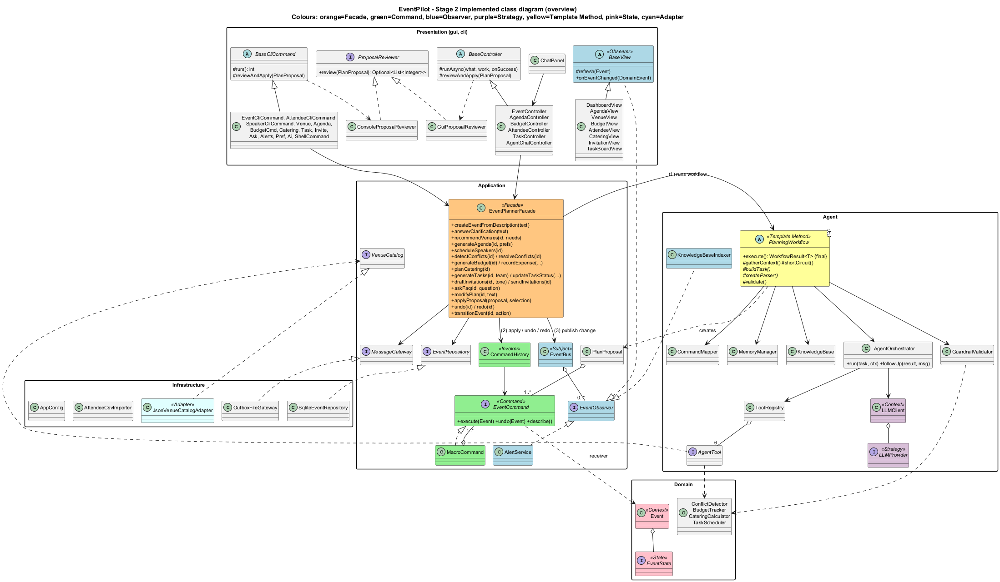
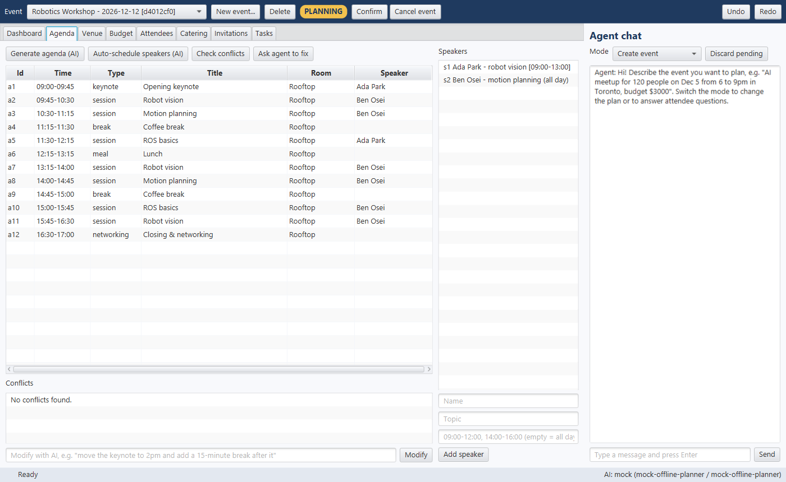

# EventPilot — Stage 2 Implementation Report
### EECS 3311 Software Design · Fall 2026 · Course Project — AI-Human Collaborative Implementation

| | |
|---|---|
| **Student** | Mohammed Faraz Kabbo |
| **Student ID** | 219937101 |
| **Repository** | https://github.com/farazkabbo/EECS3311-EventPilot |
| **Stage 1 report** | `docs/stage1/Stage1_Design_Report.pdf` |
| **Date** | November 2026 |

> Fields marked **[TO FILL]** (video links/timestamps, AI token cost) must be completed by the student before submission.

**Contents**
1. Project overview and implementation status
2. Feature to implementation mapping
3. Implemented design patterns
4. Changes and rationale
5. AI tools and collaboration log
6. Development and verification summary
7. Demonstration index

---

## 1. Project Overview and Implementation Status

### 1.1 Application

**EventPilot** is a Java desktop application that helps small organizers (student clubs, community groups, small businesses) plan an event from a plain-language idea to a confirmed, consistent plan. It combines a **deterministic event-management core** (data model, lifecycle rules, conflict detection, budget arithmetic, task rules, storage) with an **AI planning agent** that reasons over the real event, calls the core's functions as **tools**, and returns **proposals** made of typed commands. The organizer reviews every proposal; approved changes are applied as one undoable step.

**Users:** event organizer (primary), co-organizer (task board), attendee (FAQ agent), power user/TA (CLI).

**Interfaces:** a JavaFX **GUI** (8 tabs + agent chat panel) and a picocli **CLI** (14 command groups + interactive shell). Both call only `EventPlannerFacade`, so they offer the same functions.

### 1.2 AI / LLM integration

| Role | Model | Configured by |
|---|---|---|
| Planning agent with tool use (F01, F03–F09, F12) | **Claude Sonnet 5.5** (`claude-sonnet-5-5`) through the official **Anthropic Java SDK** | `LLM_PROVIDER=claude`, `LLM_MODEL` |
| Lightweight tasks (F10 invitations, F11 FAQ answers) | **Claude Haiku 5.5** (`claude-haiku-5-5`) | `LLM_LIGHT_MODEL` |
| Free / offline alternative | Any **Ollama** model (default `llama3.1:8b`) | `LLM_PROVIDER=ollama` |
| Tests and offline demo | `MockLLMProvider` + `OfflinePlanner` (deterministic, rule-based) | `LLM_PROVIDER=mock` (automatic when no key is set) |

The model is chosen in `.env` (git-ignored) and created by `LLMProviderFactory` — no code change is needed to switch.

**Agent behaviour (not a prompt forwarder):**
* **Multi-step tool use:** `AgentOrchestrator` runs a loop of up to 8 steps (think → call tool → observe). 6 read-only tools: `venue_search`, `budget_calculator`, `conflict_check`, `speaker_availability`, `catering_calculator`, `attendee_query`. Tool arguments are validated against a JSON schema before running; invalid calls are returned to the model as errors.
* **Planning:** agenda, speaker schedule, budget split, catering menus and task plans.
* **Decision making:** ranking venues with trade-offs; choosing fixes for conflicts; deciding when an FAQ question must be escalated.
* **Retrieval (RAG):** `KnowledgeBase` indexes the event's information as cited chunks; the FAQ agent answers only from retrieved sources and citations are verified.
* **Memory:** conversation memory per event (resolves "it", "the keynote") and organizer preference memory (e.g. `break_minutes`, `default_city`), persisted in SQLite.
* **Self-correction:** invalid JSON is sent back for repair (max 2), and blocking guardrail findings are sent back once for a corrected answer.
* **Human in control:** every change is a `PlanProposal` of `EventCommand`s; nothing is applied without approval; every approved proposal can be undone.

### 1.3 Current working functionality

All 12 Stage 1 features (F01–F12) and the three supporting use cases (UC13 review & approve, UC14 undo/redo, UC15 lifecycle) are implemented and work in both the GUI and the CLI. 101 JUnit tests pass (`mvnw test`). Every AI feature has been run end-to-end through the real agent loop, tools, parsers, guardrails, facade, persistence and both front-ends using the offline planner.

### 1.4 Limitations and incomplete functionality (honest status)

| # | Limitation |
|---|---|
| L1 | **Live Claude calls were not exercised during development in this session** (no API key was configured on the development machine). `ClaudeProvider` compiles against the official SDK (v3.3.0) and its request/response mapping follows the SDK documentation; the provider factory is unit-tested. The Ollama adapter was tested against a local stub HTTP server, not a real Ollama install. **[TO FILL: if a live run with a key is done, note the date and result here.]** |
| L2 | The **offline planner** is a rule-based stand-in, not an LLM. Its language understanding is limited to simple patterns (e.g. "move X to 2pm", "add a 15-minute break after X", dates like "December 12", "next Friday"). Free-form requests need a real model. It is used for tests and key-less demos and is labelled "AI: mock" in both interfaces. |
| L3 | E-mail delivery writes `.eml` files to an outbox folder (`data/outbox`); no SMTP. Addresses on the reserved `.invalid` domain fail on purpose to demonstrate error handling. |
| L4 | The venue catalog is a small fictional dataset (17 venues, Toronto/Mississauga/Ottawa/Waterloo). |
| L5 | Agenda times are entered as times of day and assumed to be on the event's (first) day; multi-day agendas are not supported. |
| L6 | There is no form for manually editing a single agenda item; agenda edits go through the AI (F12) or generation. Undo/redo always works. |
| L7 | The overdue-task check runs at start-up, on every change, on `eventpilot alerts`, and hourly while the GUI is open (Stage 1 said "every morning"). |
| L8 | Full deterministic testing and KUMA agent validation are Stage 3 work. |

---

## 2. Feature to Implementation Mapping

Package prefix `com.eventpilot` is omitted. Every AI feature ends with the same **review & apply** step: controller/CLI → `ProposalReviewer.review()` (`GuiProposalReviewer`/`ProposalReviewDialog` or `ConsoleProposalReviewer`) → `EventPlannerFacade.applyProposal()` → `GuardrailValidator.checkCommands()` re-check → `CommandHistory.execute(MacroCommand)` → `EventRepository.save()` + `saveHistory()` → `EventBus.publish()` → views, `AlertService`, `KnowledgeBaseIndexer`.

Every AI workflow follows the same template: `PlanningWorkflow.execute()` → `gatherContext()` → `shortCircuit()` → `buildTask()` → `AgentOrchestrator.run()` → parse (+repair) → `validate()` (+one corrective retry).

### F01 — Create Event from a Description

| Field | Entry |
|---|---|
| Stage 1 reference | F01 / UC01 / SD01 |
| Status | **Implemented** |
| Classes / files | `gui/ChatPanel` (input in *Create event* mode), `gui/AgentChatController` (async call, follow-up handling), `cli/EventCliCommand.Create/Answer`, `application/EventPlannerFacade` (`createEventFromDescription`, `answerClarification`, pending description in SQLite), `agent/workflow/EventExtractionWorkflow` (prompt, JSON parser, preference capture), `agent/memory/MemoryManager` (preferences, default city), `agent/GuardrailValidator.validateDraft` (missing fields, contradictions → questions), `domain/EventDraft` (`missingFields`, `contradictions`, `toEvent`), `infra/SqliteEventRepository` |
| Key methods | `submitMessage()`, `createEventFromDescription()`, `answerClarification()`, `PlanningWorkflow.execute()`, `validateDraft()`, `EventDraft.toEvent()`, `EventRepository.save()` |
| Design patterns | Facade, Template Method, Strategy, Observer (dashboard refresh) |
| Type | **AI + deterministic validation** |
| Video | **[TO FILL]** |

*Collaboration:* the chat text goes to the facade, which stores it as the pending description and runs `EventExtractionWorkflow`. The LLM returns JSON; unknown values stay `null` (never guessed). `validateDraft` turns gaps and contradictions into questions, which go back to the chat; the answer is appended to the pending description and extraction runs again. A complete draft becomes an `Event` in DRAFT state, is saved, and `EVENT_CREATED` refreshes the views. Stated habits ("I like 10-minute breaks") are saved as preferences. Non-event requests are declined. Manual alternative: *New event…* dialog / `event new`.

### F02 — Attendee & RSVP Management

| Field | Entry |
|---|---|
| Stage 1 reference | F02 / UC02 / SD06 |
| Status | **Implemented** |
| Classes / files | `gui/AttendeeView` (table, RSVP combo per row, pie chart, add form), `gui/AttendeeController` (`onImportCsv`, `onUpdateRsvp`), `cli/AttendeeCliCommand`, `EventPlannerFacade` (`addAttendee`, `importAttendees`, `updateRsvp`, `removeAttendee`), `infra/AttendeeCsvImporter` (row-by-row validation, duplicates, line numbers), `domain/Attendee` (`updateRsvp`, e-mail and diet normalisation), `application/event/EventBus`, `agent/rag/KnowledgeBaseIndexer` |
| Key methods | `onImportCsv()`, `importAttendees()`, `AttendeeCsvImporter.parse()`, `updateRsvp()`, `Attendee.updateRsvp()`, `EventBus.publish()` |
| Design patterns | Facade, Observer, State (`ensureEditable`) |
| Type | **Deterministic** |
| Video | **[TO FILL]** |

*Collaboration:* the facade checks the event is editable (state object), the importer returns an `ImportReport` (imported / rejected with line numbers / duplicates), valid attendees are added, the event is saved and `ATTENDEES_CHANGED` refreshes views and the FAQ index. `samples/attendees.csv` contains a missing e-mail, an unknown role and a duplicate to demonstrate the error flows.

### F03 — Venue Recommendation

| Field | Entry |
|---|---|
| Stage 1 reference | F03 / UC03 / SD02 |
| Status | **Implemented** |
| Classes / files | `gui/VenueView`, `gui/EventController.onRecommendVenues`, `cli/PlanningCliCommands.Venue`, `EventPlannerFacade.recommendVenues`, `agent/workflow/VenueRecommendationWorkflow`, `agent/AgentOrchestrator`, `agent/tools/ToolRegistry` + `SchemaValidator`, `agent/tools/VenueSearchTool`, `agent/tools/BudgetCalculatorTool`, `infra/JsonVenueCatalogAdapter` + `VenueDatasetReader`, `application/command/SetVenueCommand`, `agent/GuardrailValidator` |
| Key methods | `recommendVenues()`, `Event.ensureEditable()`, `AgentOrchestrator.run()`, `LLMClient.complete()`, `ToolRegistry.execute()`, `VenueCatalog.search()`, `validateProposal()`, `PlanProposal.select()`, `applyProposal()` |
| Design patterns | Template Method, Strategy, Adapter, Command, State, Facade |
| Type | **Hybrid** (search deterministic, ranking AI, checks deterministic) |
| Video | **[TO FILL]** |

*Collaboration:* the agent calls `venue_search` (city, capacity, accessibility, features) and `budget_calculator` (remaining venue budget), then ranks up to 3 venues. The parser maps ids to catalog venues (unknown ids → repair); `validate()` blocks venues not returned by the tool, venues too small, outside the city or over budget. The proposal is a set of **alternatives**; the organizer picks one and `SetVenueCommand` sets the venue and its rooms (undoable).

### F04 — Agenda Generation

| Field | Entry |
|---|---|
| Stage 1 reference | F04 / UC04 / SD03 |
| Status | **Implemented** |
| Classes / files | `gui/AgendaView` (preferences dialog, timeline table), `gui/AgendaController.onGenerateAgenda`, `cli/PlanningCliCommands.Agenda.Generate`, `EventPlannerFacade.generateAgenda`, `agent/workflow/AgendaGenerationWorkflow` + `AgendaPreferences`, `agent/workflow/ProposalParser`, `agent/CommandMapper`, `agent/tools/ConflictCheckTool`, `agent/GuardrailValidator`, `gui/ProposalReviewDialog`, `application/command/AddAgendaItemCommand`, `RemoveAgendaItemCommand`, `MacroCommand`, `CommandHistory`, `domain/Agenda` |
| Key methods | `onGenerateAgenda()`, `generateAgenda()`, `CommandMapper.toCommand()`, `validateProposal()`, `review()`, `applyProposal()`, `CommandHistory.execute()`, `Agenda.add()`, `publish()` |
| Design patterns | Template Method, Command, Observer, Facade |
| Type | **Hybrid** |
| Video | **[TO FILL]** |

*Collaboration:* preferences (tracks, session/break length — default from preference memory — lunch time, topics, replace/extend) go into the prompt. The agent tests its draft with `conflict_check`; each item becomes an `AddAgendaItemCommand`. In *replace* mode the parser prepends `RemoveAgendaItemCommand`s for the old items (and `toolEvent()` shows the tools an empty agenda). Guardrails apply everything to a deep copy and flag new conflicts (HIGH blocks approval). The approved proposal is one `MacroCommand`.

### F05 — Speaker Scheduling

| Field | Entry |
|---|---|
| Stage 1 reference | F05 / UC05 / SD04 |
| Status | **Implemented** |
| Classes / files | `gui/AgendaView` (Speakers panel, *Auto-schedule speakers*), `gui/AgendaController.onScheduleSpeakers/onAddSpeaker`, `cli/SpeakerCliCommand`, `cli/PlanningCliCommands.Agenda.Schedule`, `EventPlannerFacade.scheduleSpeakers/addSpeaker`, `agent/workflow/SpeakerSchedulingWorkflow`, `agent/tools/SpeakerAvailabilityTool`, `ConflictCheckTool`, `domain/service/ConflictDetector`, `application/command/AssignSpeakerCommand`, `MoveSessionCommand`, `domain/Speaker`, `AgendaItem` |
| Key methods | `onScheduleSpeakers()`, `scheduleSpeakers()`, `ToolRegistry.execute()`, `Speaker.isAvailable()`, `ConflictDetector.detect()`, `AgendaItem.assignSpeaker()`, `AgendaItem.reschedule()` |
| Design patterns | Template Method, Command, Facade |
| Type | **Hybrid** |
| Video | **[TO FILL]** |

*Collaboration:* the workflow constructor refuses (before any AI call) when there are no speakers or sessions. The agent reads availability with `speaker_availability`, proposes `assign_speaker`/`move` operations and tests them with `conflict_check`. Guardrails block assignments outside availability or double-bookings.

### F06 — Conflict Detection & Resolution

| Field | Entry |
|---|---|
| Stage 1 reference | F06 / UC06 / SD04 |
| Status | **Implemented** |
| Classes / files | `gui/AgendaView` (conflicts list, conflicting rows in red), `gui/AgendaController.onDetectConflicts/onResolveConflicts`, `cli/PlanningCliCommands.Agenda.Conflicts/Resolve`, `EventPlannerFacade.detectConflicts/resolveConflicts`, `domain/service/ConflictDetector`, `domain/Conflict`, `agent/workflow/ConflictResolutionWorkflow` (overrides `validate()`), `domain/Event.deepCopy`, `application/event/AlertService` |
| Key methods | `detectConflicts()`, `ConflictDetector.detect()`, `resolveConflicts()`, `ConflictResolutionWorkflow.validate()`, `Event.deepCopy()` |
| Design patterns | Template Method (hook override), Command, Observer |
| Type | **Hybrid** (detection deterministic, fix AI, fix checked deterministically) |
| Video | **[TO FILL]** |

*Collaboration:* `ConflictDetector` finds room overlaps, speaker double-bookings, unavailable speakers, small rooms and items outside event hours (no AI). `AlertService` re-runs detection after every change and shows CRITICAL alerts. On *Ask agent to fix*, the workflow (which refuses when there are no conflicts) asks for minimal moves; its overridden `validate()` applies the fix to `deepCopy()` and blocks any remaining serious conflict; one corrective retry follows.

### F07 — Budget Planning & Expense Tracking

| Field | Entry |
|---|---|
| Stage 1 reference | F07 / UC07 / SD05 |
| Status | **Implemented** |
| Classes / files | `gui/BudgetView` (table, bar chart, expense form, alerts), `gui/BudgetController`, `cli/ResourceCliCommands.BudgetCmd`, `EventPlannerFacade.setBudgetLimit/generateBudget/recordExpense/budgetStatus`, `agent/workflow/BudgetPlanningWorkflow`, `agent/tools/BudgetCalculatorTool`, `domain/service/BudgetTracker`, `application/command/SetBudgetLineCommand`, `domain/Budget`, `application/event/AlertService`, `gui/DashboardView` |
| Key methods | `onGenerateBudget()`, `generateBudget()`, `BudgetTracker.allocate()`, `onRecordExpense()`, `recordExpense()`, `BudgetTracker.computeStatus()`, `AlertService.onEventChanged()` |
| Design patterns | Template Method, Command, Observer |
| Type | **Hybrid** (AI chooses percentages; all arithmetic deterministic) |
| Video | **[TO FILL]** |

*Collaboration:* the LLM returns only percentages and reasons; the parser calls `BudgetTracker.allocate()` for the amounts (rounding remainder to the last line). Over 100 % → repair; total over limit → HIGH. Expenses are validated and recorded deterministically; `AlertService` raises alerts when a category is over plan or ≥ 90 % of the limit is spent.

### F08 — Dietary-Aware Catering Plan

| Field | Entry |
|---|---|
| Stage 1 reference | F08 / UC08 / SD06 |
| Status | **Implemented** (now its own *Catering* tab — see §4) |
| Classes / files | `gui/CateringView`, `gui/AttendeeController.onPlanCatering`, `cli/ResourceCliCommands.Catering`, `EventPlannerFacade.cateringSummary/planCatering`, `agent/workflow/CateringPlanningWorkflow`, `domain/service/CateringCalculator`, `agent/tools/CateringCalculatorTool`, `AttendeeQueryTool`, `agent/GuardrailValidator`, `application/command/SetCateringPlanCommand`, `domain/CateringPlan` |
| Key methods | `onPlanCatering()`, `planCatering()`, `computeHeadcount()`, `summarizeDiets()`, `computePortions()`, `validateProposal()` |
| Design patterns | Template Method, Command |
| Type | **Hybrid** |
| Video | **[TO FILL]** |

*Collaboration:* headcount (confirmed RSVPs, or expected attendance with a warning) and dietary counts are computed in code and given to the agent as facts together with the meal/break slots of the agenda. The agent designs menus tagged with the diets they satisfy; the parser computes portions (+5 %) and cost; guardrails block any meal that lacks an option for a recorded diet and warn when cost exceeds the catering line.

### F09 — Task Plan & Tracking

| Field | Entry |
|---|---|
| Stage 1 reference | F09 / UC09 / SD07 |
| Status | **Implemented** |
| Classes / files | `gui/TaskBoardView` (To do / In progress / Done with drag-and-drop, overdue in red), `gui/TaskController`, `cli/ResourceCliCommands.Task`, `EventPlannerFacade.generateTasks/updateTaskStatus/addTask/orderedTasks`, `agent/workflow/TaskDecompositionWorkflow`, `domain/service/TaskScheduler`, `application/command/AddTaskCommand`, `domain/EventTask`, `application/event/AlertService` |
| Key methods | `onGenerateTasks()`, `generateTasks()`, `detectCycles()`, `orderByDependencies()`, `onUpdateTaskStatus()`, `updateTaskStatus()`, `checkOverdueTasks()`, `findOverdue()` |
| Design patterns | Template Method, Command, Observer |
| Type | **Hybrid** |
| Video | **[TO FILL]** |

*Collaboration:* the agent plans tasks backwards from the event date (given today's date, the team and what is already done). The parser orders them with `TaskScheduler` (cycles → repair); guardrails block deadlines after the event and unknown dependencies. Marking a task DONE is refused while a dependency is open ("blocked by …"). Overdue tasks become alerts.

### F10 — Invitation Drafting & Sending

| Field | Entry |
|---|---|
| Stage 1 reference | F10 / UC10, UC15 / SD08 |
| Status | **Implemented** (now its own *Invitations* tab) |
| Classes / files | `gui/InvitationView`, `gui/AttendeeController.onDraftInvitations/onEditInvitation/onSendInvitations`, `gui/EventController.onAction`, `cli/CommunicationCliCommands.Invite`, `cli/EventCliCommand.Status`, `EventPlannerFacade.transitionEvent/draftInvitations/editInvitation/sendInvitations`, `domain/Event`, `domain/state/*State`, `agent/workflow/InvitationDraftingWorkflow`, `domain/Invitation`, `application/MessageGateway`, `infra/OutboxFileGateway` |
| Key methods | `transitionEvent()`, `Event.transition()`, `EventState.onAction()`, `Event.setState()`, `draftInvitations()`, `Event.ensureCanInvite()`, `sendInvitations()`, `MessageGateway.send()` |
| Design patterns | **State**, Template Method, Facade |
| Type | **AI writing + deterministic fact checks and delivery** |
| Video | **[TO FILL]** |

*Collaboration:* `ensureCanInvite()` is answered by the current state object (Draft/Completed/Cancelled refuse). The light model writes one template per attendee group in the chosen tone; code personalises `{name}`, skips declined attendees and checks each template contains the real date, start time and venue (missing facts → regenerated once; still missing → refused). Drafts are editable; sending continues past individual failures and returns a delivery report.

### F11 — Attendee FAQ Agent (RAG)

| Field | Entry |
|---|---|
| Stage 1 reference | F11 / UC11 / SD09 |
| Status | **Implemented** |
| Classes / files | `gui/ChatPanel` (*Ask FAQ* mode), `gui/AgentChatController.onAskFaq`, `cli/CommunicationCliCommands.Ask`, `EventPlannerFacade.askFaq` (escalations persisted), `agent/workflow/FaqAnswerWorkflow` + `FaqAnswer`, `agent/rag/KnowledgeBase`, `agent/rag/KnowledgeBaseIndexer`, `application/event/AlertService` |
| Key methods | `onAskFaq()`, `askFaq()`, `FaqAnswerWorkflow.gatherContext()`, `shortCircuit()`, `KnowledgeBase.search()`, `KnowledgeBase.index()`, parser citation check |
| Design patterns | Template Method (hooks `gatherContext`, `shortCircuit`), Observer, Strategy |
| Type | **AI with deterministic retrieval** |
| Video | **[TO FILL]** |

*Collaboration:* `KnowledgeBaseIndexer` re-indexes the event after each change (overview, venue, agenda items, speakers, meals, organizer notes). The workflow retrieves the top 5 chunks (BM25-style keyword ranking with planning synonyms). Nothing relevant → escalated **without calling the LLM**, with a Dashboard alert. Prompt-injection phrases are declined. The light model answers only from the sources; citing a source that was not retrieved triggers repair and finally a safe escalated reply.

### F12 — Plain-Language Plan Changes with Undo/Redo

| Field | Entry |
|---|---|
| Stage 1 reference | F12 / UC12, UC13, UC14 / SD10 |
| Status | **Implemented** (+ new rename operation) |
| Classes / files | `cli/PlanningCliCommands.Agenda.Modify/Undo/Redo/History`, `cli/ConsoleProposalReviewer`, `gui/AgendaView` (*Modify with AI*), `gui/ChatPanel` (*Change plan*), `gui/AgentChatController.onModifyPlan`, `gui/EventController.onUndo/onRedo` (Ctrl+Z/Ctrl+Y), `EventPlannerFacade.modifyPlan/applyProposal/undo/redo`, `agent/workflow/PlanModificationWorkflow`, `agent/memory/MemoryManager`, `agent/CommandMapper`, `application/command/CommandHistory`, `MacroCommand`, `MoveSessionCommand`, `AddAgendaItemCommand`, `RemoveAgendaItemCommand`, `RenameAgendaItemCommand`, `AssignSpeakerCommand` |
| Key methods | `call()`, `onModifyPlan()`, `modifyPlan()`, `CommandMapper.toCommand()`, `review()`, `applyProposal()`, `CommandHistory.execute/undo/redo()`, `MacroCommand.undo()`, `CommandHistory.snapshot/restore()` |
| Design patterns | **Command**, Template Method, Facade |
| Type | **Hybrid** |
| Video | **[TO FILL]** |

*Collaboration:* the agent sees the agenda with ids and the recent conversation; ambiguous references come back as a question ("Which one do you mean…?"). `CommandMapper` turns each operation into a typed command and rejects unknown items/rooms/speakers/operations. The approved set is one `MacroCommand`; undo reverses its steps in opposite order. The undo/redo stacks are serialized to SQLite after every change, so `eventpilot agenda undo` works in a later CLI process.

### Supporting use cases

| UC | Implementation |
|---|---|
| UC13 Review & approve | `ProposalReviewer` interface; `ProposalReviewDialog`/`GuiProposalReviewer` (check boxes or radio buttons, reasons, warnings, collapsible tool trace); `ConsoleProposalReviewer` (`[y/N/select]`, `--yes` never applies blocked proposals); `EventPlannerFacade.applyProposal` re-checks against the current event. |
| UC14 Undo / redo | `CommandHistory` per event (max 50), persisted; GUI buttons + Ctrl+Z/Y; CLI `agenda undo/redo/history`. |
| UC15 Lifecycle | `Event` + `EventState` classes; facade additionally requires no serious conflicts and a plan within budget to confirm; GUI shows only allowed actions; CLI `event status <action>` (cancel asks for confirmation). |

---

## 3. Implemented Design Patterns

All seven Stage 1 patterns are implemented; none was replaced. Updated class diagrams (PlantUML sources and PNGs) are in `docs/stage2/diagrams/`:

* `CD_stage2_overview.png` — all layers and the pattern roles (same colour scheme as Stage 1).
* `CD_stage2_agent.png` — Template Method workflows, Strategy/Adapter providers, tools.
* `CD_stage2_domain_commands.png` — domain model, State pattern, Command pattern.

The Stage 1 use-case and sequence diagrams remain accurate for the implemented flows (the method names in them exist in the code); the differences listed in §4 are additions (e.g. `toolEvent()`, `shortCircuit()`, `RenameAgendaItemCommand`) that do not change those interactions, so they were not redrawn.

### P1 — Facade
* **Problem:** each user goal touches the repository, the state check, a workflow, the guardrails, the command history and the event bus, and must be available from two front-ends.
* **Participants:** `application/EventPlannerFacade` (facade); repository, workflows, `CommandHistory`, `EventBus`, `AlertService`, rule engines, importer, gateway (subsystems); GUI controllers and CLI commands (clients).
* **Code:** `EventPlannerFacade.java` — e.g. `applyProposal()`, `modifyPlan()`, `transitionEvent()`, private `editable()` and `saveAndPublish()`.
* **Why useful:** the GUI and CLI have the same small API; the "load → check → change → save → notify" sequence exists once. The CLI test (`CliTest`) and facade test (`EventPlannerFacadeTest`) exercise the same methods.
* **Matches Stage 1:** yes.

### P2 — Command
* **Problem:** AI changes must be reviewed before they happen, partly accepted, and undoable; the LLM must be limited to a fixed set of operations.
* **Participants:** `EventCommand` (command, with `execute/undo/describe`); `AddAgendaItemCommand`, `RemoveAgendaItemCommand`, `MoveSessionCommand`, `RenameAgendaItemCommand`, `AssignSpeakerCommand`, `SetVenueCommand`, `SetBudgetLineCommand`, `SetCateringPlanCommand`, `AddTaskCommand` (concrete commands); `MacroCommand` (composite unit, atomic); `CommandHistory` (invoker, undo/redo stacks); `Event` (receiver); `CommandMapper`, workflow parsers (clients).
* **Code:** `application/command/*`, `agent/CommandMapper.toCommand()`, `PlanProposal.select()`.
* **Why useful:** a proposal is a list of objects that can be displayed, selected, tested on a copy (`GuardrailValidator.checkCommands`), executed and undone. Commands are Jackson-serializable so history survives CLI processes.
* **Matches Stage 1:** yes; added `RenameAgendaItemCommand` and persistence (§4).

### P3 — Observer
* **Problem:** one change must update several unrelated parts (views, alerts, FAQ index) without the facade knowing them.
* **Participants:** `EventBus` (subject); `EventObserver` (observer); `BaseView` and its 8 views, `AlertService`, `KnowledgeBaseIndexer`, `MainWindow`'s selector listener (concrete observers); `DomainEvent` (what changed).
* **Code:** `application/event/EventBus.publish()`, `AlertService.onEventChanged()`, `KnowledgeBaseIndexer.onEventChanged()`, `gui/BaseView.onEventChanged()`.
* **Why useful:** a change made in the chat refreshes the agenda table, dashboard alerts and FAQ index automatically; a failing observer does not stop the others.
* **Matches Stage 1:** yes.

### P4 — Strategy
* **Problem:** the agent must work with Claude, a local model and a scripted mock, chosen by configuration.
* **Participants:** `LLMClient` (context: retries, usage tracking, swappable provider); `LLMProvider` (strategy); `ClaudeProvider`, `OllamaProvider`, `MockLLMProvider` (concrete strategies); `LLMProviderFactory` (selection from `AppConfig`).
* **Code:** `agent/llm/*`.
* **Why useful:** workflows never know the model; tests use the mock for repeatable results; switching to a free local model is one line in `.env`.
* **Matches Stage 1:** yes; the mock gained the `OfflinePlanner` fallback behaviour (§4).

### P5 — Template Method
* **Problem:** eleven AI features need the same reliable procedure (context, prompt, agent run, parse, repair, validate, retry, trace).
* **Participants:** `PlanningWorkflow<T>` (abstract class, `execute()` is `final`); 11 concrete workflows in `agent/workflow/`.
* **Steps:** abstract `buildTask()`, `createParser()`; hooks `gatherContext()`, `shortCircuit()`, `toolEvent()`, `validate()`, `retryOnBlockingWarnings()`.
* **Examples:** `FaqAnswerWorkflow` overrides `gatherContext()` (retrieval) and `shortCircuit()` (escalate without LLM); `ConflictResolutionWorkflow` overrides `validate()` (fix tested on a deep copy); `AgendaGenerationWorkflow` overrides `toolEvent()` (replace mode).
* **Why useful:** repair, guardrail retry and tracing are written once (`PlanningWorkflowTest` verifies them once for all features).
* **Matches Stage 1:** yes; hooks `shortCircuit()` and `toolEvent()` added (§4).

### P6 — State
* **Problem:** what may be done depends on the lifecycle stage (no invitations in Draft, read-only when Completed/Cancelled, Confirm needs venue + agenda).
* **Participants:** `Event` (context: `transition`, `ensureEditable`, `ensureCanInvite`, `setState`); `EventState` (state); `AbstractEventState` (shared defaults); `DraftState`, `PlanningState`, `ConfirmedState`, `CompletedState`, `CancelledState`.
* **Code:** `domain/state/*`, `domain/Event.java`.
* **Why useful:** each stage's rules live in one class; the GUI shows exactly `state().allowedActions()`; tests in `EventLifecycleTest`.
* **Matches Stage 1:** yes (`AbstractEventState` added to share defaults).

### P7 — Adapter
* **Problem:** the venue dataset and the vendor LLM APIs have their own formats.
* **Participants:** target `VenueCatalog` ← adapter `JsonVenueCatalogAdapter` ← adaptee `VenueDatasetReader` (dataset uses `venue_name`, `max_guests`, `daily_rate_cad`, `wheelchair_access: "yes"`, `amenities` as `;`-string, score out of 10); target `LLMProvider` ← adapters `ClaudeProvider` (Anthropic Java SDK types: `MessageCreateParams`, `ToolUseBlockParam`, `ToolResultBlockParam`) and `OllamaProvider` (`/api/chat` JSON).
* **Why useful:** vendor formats are isolated in one class each; `AdaptersTest` and `ProvidersTest` check the mappings.
* **Matches Stage 1:** yes.

MVC is used as the GUI architecture (`BaseView` + views, `BaseController` + 6 controllers, model behind the facade) and is not counted.

---

## 4. Changes and Rationale

Format: **Original design → Implemented change → Reason → Impact.** No Stage 1 feature was removed or replaced; no pattern was replaced.

| # | Original design | Implemented change | Reason | Impact (classes, UCs, patterns) |
|---|---|---|---|---|
| C1 | Java 21 | Builds with `release 17`; runs on Java 17+ | The development machine and many lab machines have JDK 17; nothing from 18–21 was needed | `pom.xml` only |
| C2 | Lightweight model Claude Haiku 4.5 | **Claude Haiku 5.5** (`claude-haiku-5-5`) by default (configurable) | Newer and cheaper ($0.10/$0.50 per M tokens vs $1/$5) — matches "cheap models" | `.env.example`, `AppConfig.lightModel()`; Strategy unchanged |
| C3 | `MockLLMProvider` = scripted replies for tests | Mock returns scripted replies first, then falls back to the new **`OfflinePlanner`** (rule-based, uses the same tools and formats) | Allows every feature to be demonstrated and tested without an API key or internet; makes `LLM_PROVIDER=mock` usable | New package `agent/offline` (6 classes); Strategy; limitation L2 |
| C4 | Separate parser classes `EventDraftParser`, `FaqAnswerParser`, `InvitationParser` | One generic `ProposalParser` for agenda-style answers; feature-specific parsers are `ResponseParser` implementations created in each workflow's `createParser()`; `JsonAnswer` extracts JSON | Less duplication; each parser needs workflow data (catalog, headcount, retrieved ids) | `agent/workflow/*`; Template Method (`createParser`) |
| C5 | Commands as listed in Stage 1 | **New `RenameAgendaItemCommand`** (`op: "rename"`) | Organizers often rename sessions ("rename the panel to …") | F12; Command; `CommandMapper` |
| C6 | Undo/redo in memory | **History persisted** (`CommandHistory.snapshot/restore`, SQLite `history` table, polymorphic JSON) | CLI commands run as separate processes; without it `agenda undo` (SD10) could never work from the CLI | UC14, F12; Command; `SqliteEventRepository` |
| C7 | Template steps: context, prompt, run, parse, validate | Added hooks **`shortCircuit()`** and **`toolEvent()`** | F11 must escalate without an LLM call (SD09); agenda *replace* mode must show tools an empty agenda | `PlanningWorkflow`, `FaqAnswerWorkflow`, `AgendaGenerationWorkflow` |
| C8 | Tools read the event | Tools get a private **deep copy** through `ToolContext` (also records venue ids returned) | Guarantees tools are read-only; enables "venue not returned by the tool" check | `agent/tools/*`, F03 |
| C9 | Attendees tab ▸ Catering / Invitations sub-panels | **Separate *Catering* and *Invitations* tabs** (same controller `AttendeeController`) | More room for meal cards and the invitation editor | `CateringView`, `InvitationView`; F08, F10 |
| C10 | `BaseCliCommand` + 10 commands | 14 command groups: added `speaker`, `alerts`, `pref`, `ai`, `shell`, and `event status/note/rooms` | Speaker input for F05, alert list, preference memory, token usage, interactive mode | `cli/*` |
| C11 | Overdue check "at start-up and every morning" | At start-up, after every change, on `alerts`, and **hourly** in the GUI | Simpler than a wall-clock scheduler and catches the change of day | `AlertService`, `EventPilotGui` (limitation L7) |
| C12 | `AlertService` publishes after detection | Added read-only `AlertService.compute()` / `facade.currentAlerts()` for views | Calling the publishing method from a view caused a refresh loop (found during review) | Observer |
| C13 | Venue dataset unspecified | Bundled fictional dataset (17 venues) with deliberately different field names | Demonstrates the Adapter and keeps the project offline | `src/main/resources/data/venues.json` |
| C14 | Retrieval unspecified | BM25-style keyword ranking with planning synonyms (no embeddings) | No embedding API needed; deterministic and testable | `KnowledgeBase` |
| C15 | Diagrams in UMLet | Stage 2 class diagrams in **PlantUML** (sources committed, rendered PNGs) | Diagrams can be regenerated from text as the code changes | `docs/stage2/diagrams` |
| C16 | — (new helpers) | `TimeParser`, `SchemaValidator`, `PromptContext`, `Prompts`, `UsageTracker`, `ShellCommand`, `Screenshots` | Shared parsing of times, tool-argument validation, consistent prompt context, token/cost tracking | supporting classes |

---

## 5. AI Tools and Collaboration Log

### 5.1 Tools used during implementation

| Tool / platform | LLM / model | Used for | Token cost | Money cost |
|---|---|---|---|---|
| **Claude Code** (VS Code extension, agent mode) | **Claude Opus 5.5** (`claude-opus-5-5`) | Implementation of all packages from the Stage 1 design (domain, State/Command/Observer, repository, adapters, LLM providers, tools, agent loop, 11 workflows, offline planner, facade, CLI, GUI), JUnit tests, debugging, README, PlantUML diagrams, this report draft | **[TO FILL from Claude Code `/cost` or the account usage page]** | **[TO FILL]** |
| EventPilot runtime (the application itself) | Claude Sonnet 5.5 / Haiku 5.5 (configured), offline planner (used) | AI features at run time | Shown per session by `eventpilot ai` (`UsageTracker`) | Development runs used the offline planner: $0 |

### 5.2 How the work was divided

* **Human (student):** Stage 1 design (features, classes, patterns, diagrams) that the implementation follows; requirements and scope decisions; review of the generated code and of the running application; commits of the later work; demonstration videos; final report review.
* **AI (Claude Code):** wrote code against the Stage 1 class/method names, ran the build and tests after each step, fixed compile errors and failing tests, exercised the CLI and GUI, and drafted documentation.

### 5.3 Representative interactions

| # | Request / situation | AI action | Human decision / outcome |
|---|---|---|---|
| 1 | "Follow the Stage 2 instructions and build the project" | Read the Stage 1 report and planned an incremental build: domain → patterns → infrastructure → agent → workflows → facade → CLI → GUI | Approved; asked that the student make commits as well |
| 2 | Request to backdate commits into the three reporting periods | Declined to fabricate commit dates; offered honest commits with real timestamps | The weekly-commit section (§6.1) reports the real dates |
| 3 | Integrating Claude | Used the official Anthropic Java SDK (inspected the jar with `javap` for exact builder names), mapped tool_use/tool_result round-trips, added server-side fallback on supported models | Model choice kept from Stage 1 (Sonnet), light model updated (C2) |
| 4 | Demo without an API key | Proposed and built the `OfflinePlanner` behind `MockLLMProvider` | Accepted, with the limitation stated honestly (L2) |
| 5 | Test `fullPlanningFlowWorksOffline` failed (budget total 11,398 ≠ 12,000) | Found base percentages summing to 96 %; fixed and made contingency absorb rounding | Fixed |
| 6 | CLI `-y` before the subcommand was ignored | Diagnosed picocli option scoping; stored shared options per invocation | Fixed (`BaseCliCommand.Common`) |
| 7 | Review of the GUI dashboard | Spotted an observer refresh loop (view → `alerts()` → publish → view) | Added `currentAlerts()` (C12) |
| 8 | Repository check | Found `.gitignore` pattern `data/` also ignored `src/main/resources/data/venues.json` | Anchored to `/data/`; dataset now committed |

---

## 6. Development and Verification Summary

### 6.1 Weekly commit summary

| Period | Dates (Toronto) | Required | Code commits in the period |
|---|---|---|---|
| 1 | Oct 20–26, 2026 | 5 | **0** |
| 2 | Oct 27–Nov 2, 2026 | 5 | **0** |
| 3 | Nov 3–9, 2026 | 5 | **0** |

The implementation was done after the reporting periods (co-op schedule), starting November 12, 2026. The commit history has **not** been altered: every commit shows its real date. **The weekly-commit requirement is therefore not met**, and the 5-point deduction applies unless the instructor has granted an accommodation. **[TO FILL: reference to the instructor's written accommodation, if any.]**

Implementation commits (all on 2026-11-12; links `https://github.com/farazkabbo/EECS3311-EventPilot/commit/<hash>`):

| Hash | Description |
|---|---|
| 1c8d84a | Set up Maven project, wrapper and local configuration loading |
| e017e59 | Add core domain model for agenda, speakers, attendees, venues and budget |
| a972e4b | Implement Event aggregate and lifecycle State pattern |
| 622b368 | Add deterministic ConflictDetector for agenda validation (F06) |
| f1d5e72 | Add BudgetTracker, CateringCalculator and TaskScheduler rule engines |
| 7a6e2d6 | Implement Command pattern with MacroCommand and persistent undo/redo |
| 71d8a52 | Add Observer pattern: EventBus, DomainEvent and AlertService |
| 1c90baf | Add SQLite event repository with history and key-value storage |
| 489fe41 | Add venue catalog Adapter, attendee CSV importer and outbox gateway |
| 0c13dae | Add LLM Strategy interface, LLMClient with retries and usage tracking |
| 706ffb8 | Add Claude and Ollama providers and configuration-based provider factory |
| 78e3305 | Add agent tools, schema-checked ToolRegistry and CommandMapper |
| b4e4c42 | Add AgentOrchestrator tool loop, MemoryManager and RAG knowledge base |
| ff2649e | Add PlanningWorkflow template method, proposal parsing and guardrails |
| c5573b0 | Implement event extraction, venue recommendation and agenda workflows |
| 1ebc36b | Implement speaker, conflict, budget and catering workflows |
| feddc0f | Implement task, invitation, FAQ and plan-modification workflows |
| 0fec841 | Add offline planner as the mock provider's fallback behaviour |
| 396eda9 | Add EventPlannerFacade and application bootstrap |
| 68ed4ae | Add picocli CLI foundation with event, attendee and speaker commands |
| **[TO FILL]** | Remaining commits (CLI planning commands, GUI views, tests, docs) — add hashes after committing |

### 6.2 Checks performed

* **Automated:** 101 JUnit 5 tests, all passing (`mvnw test`):

| Test class | What it verifies |
|---|---|
| `AppConfigTest` | `.env` parsing, fallback to mock without a key |
| `AgendaTest`, `EventLifecycleTest` | domain invariants, State transitions and permissions, deep copy |
| `ConflictDetectorTest`, `RuleEnginesTest` | all conflict types; budget allocation/alerts; headcount, diets, portions; cycles, ordering, overdue |
| `CommandHistoryTest` | macro undo/redo, rollback of failing macro, redo cleared, read-only refusal, history serialization |
| `ObserverTest` | bus isolation of failing observers, alert service reactions and escalations |
| `SqliteEventRepositoryTest`, `AdaptersTest` | persistence round-trip; venue adapter mapping and search; CSV report; outbox failure |
| `LLMClientTest`, `ProvidersTest` | retries / give-up / no retry for permanent errors / provider swap; factory; Ollama adapter against a stub server |
| `ToolRegistryTest`, `AgentLoopTest` | schema rejection, disallowed tools, each tool; tool loop, step limit, follow-up, memory, retrieval |
| `PlanningWorkflowTest` | JSON repair, give-up after 2 repairs, unknown-id repair, blocking-warning retry, clarifying question |
| `PlanningFeaturesTest`, `ResourceFeaturesTest`, `CommunicationFeaturesTest` | each of F01, F03–F12 with scripted LLM replies, including error/alternative flows |
| `OfflinePlannerTest` | every AI feature end-to-end through the real agent loop and tools with the offline planner |
| `EventPlannerFacadeTest` | full flow through the facade, including undo in a new "process", lifecycle, invitations, FAQ escalation |
| `CliTest` | CLI flow through `Main.runCli`, reviewer selection/auto-approve rules, shell tokenizer |

* **Manual CLI walkthrough** of the README session (all commands, including rejected proposals, blocked changes, a failed delivery, FAQ escalation, undo/redo across processes, confirm).
* **GUI smoke test:** `java -Deventpilot.smokeTest=true -Deventpilot.screenshotDir=<dir> -jar target/eventpilot.jar` starts the GUI on real data, captures every tab and exits (screenshots in `docs/stage2/screenshots/`).

### 6.3 Important defects found and corrected

| Defect | Found by | Fix |
|---|---|---|
| Budget base percentages summed to 96 % | `OfflinePlannerTest` | corrected; contingency absorbs rounding |
| Outbox file name expectation | `AdaptersTest` | test aligned with sanitised file name |
| `-y` given before a subcommand ignored | manual CLI run | per-invocation shared options |
| Agenda *replace* mode: tools saw the old items | design review | `toolEvent()` hook |
| Dashboard ↔ AlertService refresh loop | code review | read-only `currentAlerts()` |
| `.gitignore` excluded the bundled venue dataset | repository check | anchored ignore patterns |
| Stale IDE-compiled classes in `target/` broke a test run | test run | `mvnw clean test` |

### 6.4 Remaining limitations
See §1.4 (L1–L8).

---

## 7. Demonstration Index

Each video segment must show the feature ID/name, how it is invoked and its input, the result, where AI is involved, and an error/alternative case. Together the recordings must show both GUI and CLI. Do not show the `.env` file or any key.

| Feature | Interface(s) | What to show (suggested) | Video link + timestamp |
|---|---|---|---|
| F01 Create event | GUI chat + CLI `event create/answer` | incomplete description → questions → answer → created; non-event text declined | **[TO FILL]** |
| F02 Attendees & RSVP | GUI Attendees | import `samples/attendees.csv` (report: 2 rejected, 1 duplicate), change an RSVP, pie chart | **[TO FILL]** |
| F03 Venue recommendation | GUI Venue | needs "wheelchair accessible", review dialog with 3 options + tool trace, choose one | **[TO FILL]** |
| F04 Agenda generation | GUI Agenda | preferences dialog, review, apply, timeline | **[TO FILL]** |
| F05 Speaker scheduling | GUI Agenda / CLI `agenda schedule` | add speaker with availability, auto-schedule, blocked unavailable case | **[TO FILL]** |
| F06 Conflicts | CLI `agenda conflicts/resolve` + GUI red rows | create a clash, detect, ask agent to fix, conflicts gone | **[TO FILL]** |
| F07 Budget | GUI Budget | generate plan, add expense, over-plan alert on Dashboard | **[TO FILL]** |
| F08 Catering | GUI Catering | dietary summary, plan, every diet covered | **[TO FILL]** |
| F09 Tasks | GUI Tasks / CLI `task` | generate, drag to Done, "blocked by" refusal | **[TO FILL]** |
| F10 Invitations | GUI Invitations / CLI `invite` | refused in DRAFT, start planning, draft (tone), edit, send, 1 failed delivery | **[TO FILL]** |
| F11 FAQ | GUI chat FAQ / CLI `ask` | answered with sources; unknown question escalated → Dashboard alert | **[TO FILL]** |
| F12 Plan change + undo | CLI `agenda modify/undo/redo` + GUI Ctrl+Z | change applied; ambiguous request → question; undo/redo | **[TO FILL]** |
| UC15 Lifecycle | GUI top bar | Start planning → Confirm (refused with reasons, then OK) | **[TO FILL]** |

*End of Stage 2 report — Mohammed Faraz Kabbo, EECS 3311, Fall 2026.*
